# GenAI Processors: A Framework for Modular, Asynchronous AI Pipelines

## Overview

The `genai-processors` library is a lightweight Python framework designed from first principles to simplify the construction of complex, modular, asynchronous, and composable AI pipelines, particularly for Generative AI applications. At its core, it abstracts units of work into fundamental `Processor` components that operate on streams of data. This design allows developers to break down intricate AI tasks into manageable, reusable blocks that can be easily chained together for sequential processing or parallelized for concurrent execution.

The framework's emphasis on stream-based data flow, powered by Python's `asyncio`, enables efficient, real-time content processing, making it ideal for interactive AI agents. It provides a unified interface for interacting with various AI models (like Google GenAI and Ollama), handles diverse content modalities (text, audio, images, PDFs, external API data), and offers mechanisms for state management and operational concerns like caching and debugging.

This documentation serves as a comprehensive guide to understanding `genai-processors`, from its foundational architectural concepts to practical application in building command-line tools, real-time agents, and advanced multi-step workflows.

## Table of Contents

1.  [The `genai-processors` Architecture: A High-Level Overview](#the-genai-processors-architecture-a-high-level-overview)
    *   [The Core `Processor` Abstraction and its Lifecycle](#the-core-processor-abstraction-and-its-lifecycle)
        *   [`Processor` Invocation (`__call__`) Internal Flow](#processor-invocation-call-internal-flow)
        *   [`ProcessorPart`](#processorpart)
        *   [`ProcessorPart` Structure and Attributes](#processorpart-structure-and-attributes)
        *   [`PartProcessor`](#partprocessor)
        *   [`Processor` vs. `PartProcessor` Comparison](#processor-vs-partprocessor-comparison)
        *   [Core `genai-processors` Component Relationships](#core-genai-processors-component-relationships)
    *   [Chaining Processors to Form Processing Pipelines](#chaining-processors-to-form-processing-pipelines)
        *   [Processor Chaining (`+` Operator) Data Flow](#processor-chaining--operator-data-flow)
        *   [Processor Parallelization (`//` Operator) Data Flow](#processor-parallelization--operator-data-flow)
    *   [The Role of `Streams` in Managing Data Flow](#the-role-of-streams-in-managing-data-flow)
        *   [Core `genai-processors` Utility Functions](#core-genai-processors-utility-functions)
    *   [How the `Context` Object Manages and Shares State Across a Pipeline](#how-the-context-object-manages-and-shares-state-across-a-pipeline)
        *   [Reserved Substreams in `genai-processors`](#reserved-substreams-in-genai-processors)
    *   [Illustrative Pipeline Diagram: Real-Time Live Example](#illustrative-pipeline-diagram-real-time-live-example)
2.  [Tutorial: Building Your First Command-Line Application](#tutorial-building-your-first-command-line-application)
    *   [Setting Up the Python Environment and Installing Dependencies](#setting-up-the-python-environment-and-installing-dependencies)
        *   [GenAI Processors Library Installation Dependencies](#genai-processors-library-installation-dependencies)
    *   [Importing and Instantiating Necessary Processor Classes](#importing-and-instantiating-necessary-processor-classes)
        *   [Core GenAI Processor Class Relationships](#core-genai-processor-class-relationships)
        *   [Common GenAI Processor Classes and Instantiation Examples](#common-genai-processor-classes-and-instantiation-examples)
    *   [Configuring Processors with Necessary Parameters](#configuring-processors-with-necessary-parameters)
        *   [GenaiModel Configuration Parameters](#genaimodel-configuration-parameters)
        *   [TextToSpeech Processor Configuration Parameters](#texttospeech-processor-configuration-parameters)
    *   [Linking Processors Together to Form a Sequential Pipeline](#linking-processors-together-to-form-a-sequential-pipeline)
        *   [GenAI Processor Pipeline Data Flow](#genai-processor-pipeline-data-flow)
        *   [Real-time Conversational Agent Pipeline Example](#real-time-conversational-agent-pipeline-example)
    *   [Executing the Final Script and Handling its Input and Output](#executing-the-final-script-and-handling-its-input-and-output)
        *   [CLI Application Asynchronous Execution Flow](#cli-application-asynchronous-execution-flow)
3.  [Integrating with Generative AI Models: Google GenAI and Ollama](#integrating-with-generative-ai-models-google-genai-and-ollama)
    *   [Common Interface for Interacting with Different Models](#common-interface-for-interacting-with-different-models)
        *   [Core `Processor` Interface and Content Handling](#core-processor-interface-and-content-handling)
        *   [GenAI Processors `Processor` Interface Summary](#genai-processors-processor-interface-summary)
        *   [GenAI Processors Pipeline Data Flow](#genai-processors-pipeline-data-flow)
    *   [Configuring Credentials and Selecting a Model for `GenAIModelProcessor`](#configuring-credentials-and-selecting-a-model-for-genaimodelprocessor)
        *   [`GenAIModelProcessor` Initialization Parameters](#genaimodelprocessor-initialization-parameters)
        *   [Google GenAI `model_name` Formats](#google-genai-model_name-formats)
    *   [Connecting to a Local Ollama Instance using `OllamaModelProcessor`](#connecting-to-a-local-ollama-instance-using-ollamamodelprocessor)
        *   [Ollama Local Setup and Integration Workflow](#ollama-local-setup-and-integration-workflow)
        *   [OllamaModelProcessor to Local Ollama API Interaction](#ollamamodelprocessor-to-local-ollama-api-interaction)
        *   [`OllamaModelProcessor` Configuration and Defaults](#ollamamodelprocessor-configuration-and-defaults)
    *   [Purpose of `LiveModel` and its Difference from a Standard Model Processor](#purpose-of-livemodel-and-its-difference-from-a-standard-model-processor)
        *   [`Realtime.LiveModelProcessor` Adaptation Mechanism](#realtime.livemodelprocessor-adaptation-mechanism)
    *   [Approach to Extend the Library to Support a New Model Provider (e.g., Anthropic Claude)](#approach-to-extend-the-library-to-support-a-new-model-provider-eg-anthropic-claude)
        *   [Extending GenAI Processors for a New Model Provider](#extending-genai-processors-for-a-new-model-provider)
4.  [Real-time Audio and Speech Processing](#real-time-audio-and-speech-processing)
    *   [How is an audio input stream captured and chunked for processing?](#how-is-an-audio-input-stream-captured-and-chunked-for-processing)
        *   [Audio Input Stream Capture and Chunking Process](#audio-input-stream-capture-and-chunking-process)
    *   [What are the underlying services or libraries used for STT and TTS?](#what-are-the-underlying-services-or-libraries-used-for-stt-and-tts)
        *   [Core GenAI Processors Capabilities Summary](#core-genai-processors-capabilities-summary)
    *   [How does the `realtime.py` module facilitate low-latency, bidirectional interactions?](#how-does-the-realtimepy-module-facilitate-low-latency-bidirectional-interactions)
        *   [Bidirectional Interaction via LiveProcessor](#bidirectional-interaction-via-liveprocessor)
        *   [Gemini Live API Features for Low-Latency Interaction](#gemini-live-api-features-for-low-latency-interaction)
    *   [What is the function of the `RateLimitAudio` processor in managing audio streams?](#what-is-the-function-of-the-ratelimitaudio-processor-in-managing-audio-streams)
        *   [`RateLimitAudio` Processor Functionality](#ratelimitaudio-processor-functionality)
    *   [Walk through the code of `realtime_simple_cli.py` to explain a complete STT -> LLM -> TTS loop.](#walk-through-the-code-of-realtime_simple_cli.py-to-explain-a-complete-stt---llm---tts-loop)
        *   [Real-time Conversational AI Pipeline (STT -> LLM -> TTS)](#real-time-conversational-ai-pipeline-stt---llm---tts)
5.  [Advanced Use Case: Building a Multi-Step Research Agent](#advanced-use-case-building-a-multi-step-research-agent)
    *   [Overall Architecture and Departure from a Simple Linear Pipeline](#overall-architecture-and-departure-from-a-simple-linear-pipeline)
        *   [Multi-Step Research Agent Workflow](#multi-step-research-agent-workflow)
    *   [State Management and Information Passing](#state-management-and-information-passing)
    *   [Analysis of Prompts in `prompts.py`](#analysis-of-prompts-in-prompts.py)
        *   [LLM Prompting Strategy in Research Agent](#llm-prompting-strategy-in-research-agent)
    *   [Implementation and Composition of Custom Processors](#implementation-and-composition-of-custom-processors)
        *   [Research Agent Processors Overview](#research-agent-processors-overview)
        *   [Core Classes and Relationships in Research Agent](#core-classes-and-relationships-in-research-agent)
    *   [Design Patterns Applicable to Other Complex, Agentic Workflows](#design-patterns-applicable-to-other-complex-agentic-workflows)
        *   [Design Patterns for Agentic Workflows](#design-patterns-for-agentic-workflows)
6.  [Handling Multimodal Content: PDF, Video, and External APIs](#handling-multimodal-content-pdf-video-and-external-apis)
    *   [How the `PdfProcessor` Extracts Text and Metadata from PDF Files](#how-the-pdfprocessor-extracts-text-and-metadata-from-pdf-files)
        *   [PDF Extraction Process with PdfProcessor](#pdf-extraction-process-with-pdfprocessor)
        *   [PdfProcessor Input and Output Summary](#pdfprocessor-input-and-output-summary)
    *   [Capabilities of the `VideoProcessor`](#capabilities-of-the-videoprocessor)
    *   [How `DriveProcessor` and `GitHubProcessor` Authenticate and Fetch Data](#how-driveprocessor-and-githubprocessor-authenticate-and-fetch-data)
        *   [External API Processor Authentication Methods](#external-api-processor-authentication-methods)
        *   [Google Drive Data Fetching Workflow](#google-drive-data-fetching-workflow)
        *   [Google Drive Processors Capabilities](#google-drive-processors-capabilities)
        *   [GitHub Data Fetching Workflow](#github-data-fetching-workflow)
    *   [Role of `content_api.py` and `mime_types.py` in Routing and Handling Data Formats](#role-of-content_api.py-and-mime_types.py-in-routing-and-handling-data-formats)
        *   [ProcessorPart Core Data Structure](#processorpart-core-data-structure)
        *   [Key MIME Types and Their Categories](#key-mime-types-and-their-categories)
        *   [Generic GenAI Processor Pipeline Flow](#generic-genai-processor-pipeline-flow)
    *   [Building a Pipeline for Google Drive Content](#building-a-pipeline-for-google-drive-content)
7.  [Operational Concerns: Caching, Debugging, and Configuration](#operational-concerns-caching-debugging-and-configuration)
    *   [Caching Mechanism Implementation](#caching-mechanism-implementation)
        *   [Caching Component Relationships](#caching-component-relationships)
        *   [ProcessorContent Cache Key Generation Flow](#processorcontent-cache-key-generation-flow)
        *   [ProcessorContent Caching Serialization/Deserialization Flow](#processorcontent-caching-serializationdeserialization-flow)
    *   [Caching Configuration and Control](#caching-configuration-and-control)
        *   [InMemoryCache Configuration Parameters](#inmemorycache-configuration-parameters)
        *   [Cache Isolation with `with_key_prefix`](#cache-isolation-with-with_key_prefix)
    *   [Debugging Mechanisms](#debugging-mechanisms)
        *   [GenaiModel Debug Configuration Flow](#genaimodel-debug-configuration-flow)
    *   [Project-Level Configurations in `pyproject.toml`](#project-level-configurations-in-pyproject.toml)
    *   [Environment Variables for Sensitive Data](#environment-variables-for-sensitive-data)
        *   [Summary of Operational Concerns in `genai-processors`](#summary-of-operational-concerns-in-genai-processors)
8.  [Case Study: The Live AI Commentator Web Application](#case-study-the-live-ai-commentator-web-application)
    *   [Live AI Commentator Web Application - High-Level Architecture and Data Flow](#live-ai-commentator-web-application---high-level-architecture-and-data-flow)
    *   [End-to-End Data Flow](#end-to-end-data-flow)
        *   [Frontend-to-Backend Data Types and Mimetypes](#frontend-to-backend-data-types-and-mimetypes)
        *   [Backend `LiveCommentator` Processor Pipeline](#backend-livecommentator-processor-pipeline)
        *   [Backend-to-Frontend Output Types and Mimetypes](#backend-to-frontend-output-types-and-mimetypes)
    *   [Python Backend (`commentator.py`) and Continuous Generation](#python-backend-commentator.py-and-continuous-generation)
        *   [`LiveCommentator` Agent Tools/Functions](#livecommentator-agent-toolsfunctions)
        *   [LiveCommentator Agent State Machine](#livecommentator-agent-state-machine)
    *   [Role of `commentator_ais.py` and its Relation to `ais_app`](#role-of-commentator_ais.py-and-its-relation-to-ais_app)
        *   [AI Studio Application Metadata and Permissions](#ai-studio-application-metadata-and-permissions)
    *   [Frontend (`index.tsx`) Connection to Python Backend](#frontend-index.tsx-connection-to-python-backend)
        *   [Live AI Commentator - Detailed Bidirectional WebSocket Communication](#live-ai-commentator---detailed-bidirectional-websocket-communication)
    *   [Web Technologies for Data Streaming](#web-technologies-for-data-streaming)
9.  [Conclusion](#conclusion)

---

## 1. The `genai-processors` Architecture: A High-Level Overview

At its core, `genai-processors` is built upon the fundamental idea of breaking down complex AI tasks into atomic, reusable units. This modularity is achieved through its central abstraction: the `Processor`.

### The Core `Processor` Abstraction and its Lifecycle

The `Processor` is the fundamental building block in `genai-processors`, encapsulating any unit of work. It operates on streams of data, enabling efficient, parallel content processing.

*   **Definition**: A `Processor` is conceptually a function that takes an asynchronous stream of `ProcessorPart`s as input and returns an asynchronous stream of `ProcessorPart`s (or compatible types) as output. This stream-in, stream-out paradigm is foundational to the framework's design.
*   **Core Method (`call`)**: Any class inheriting from `processor.Processor` must implement the `async def call(content: AsyncIterable[ProcessorPart]) -> AsyncIterable[ProcessorPartTypes]` method. This method defines the actual processing logic that transforms the input stream into the output stream.
*   **Invocation (`__call__`)**: While developers implement `call()`, the `Processor`'s `__call__` method is the convenient way to invoke it. This `__call__` method handles crucial internal aspects:
    *   **Input Normalization**: It ensures that any input (which might be a single `ProcessorPart`, a list of parts, or even a string) is consistently converted into an `AsyncIterable` of `ProcessorPart`s.
    *   **Asynchronous Task Management**: It manages asynchronous tasks within an `asyncio.TaskGroup`, ensuring robust execution of the `call` method.
    *   **Robust Generator Output**: It uses an internal `asyncio.Queue` to manage the output from the `call` method, providing a resilient mechanism for streaming results as they become available.

#### `Processor` Invocation (`__call__`) Internal Flow
This flowchart details the internal workings of a `Processor`'s `__call__` method, showing how it normalizes input, manages asynchronous tasks with `asyncio.TaskGroup`, and uses `asyncio.Queue` for robust output streaming.

```mermaid
graph TD
    Call_Entry[__call__ Entry]

    subgraph Input_Processing
        Normalize_Input[Normalize Input]
    end

    subgraph Async_Execution
        Init_Output_Queue[Init Output Queue]
        Init_TaskGroup[Init TaskGroup]
        Spawn_Call_Task[Spawn call() Task]
        Wait_Tasks[Wait for Tasks]
    end

    subgraph Output_Handling
        Stream_Output[Stream Output]
    end

    Call_Entry --> Normalize_Input
    Normalize_Input --> Init_Output_Queue
    Init_Output_Queue --> Init_TaskGroup
    Init_TaskGroup --> Spawn_Call_Task
    Spawn_Call_Task --> Stream_Output
    Stream_Output --> Wait_Tasks
    Wait_Tasks --> Call_Exit[__call__ Exit]
```

#### `ProcessorPart`
The `ProcessorPart` is the fundamental unit of data that flows through `genai-processors` pipelines. It's a versatile wrapper around `genai.types.Part` that is enriched with essential metadata. This abstraction allows the framework to handle diverse content types uniformly.

*   **Content and Metadata**: A `ProcessorPart` encapsulates content (e.g., text, image bytes, audio data, custom JSON) and crucial metadata such as:
    *   **MIME type**: Specifies the format of the content (e.g., `text/plain`, `image/jpeg`, `application/json`). This is vital for processors to understand and route data correctly.
    *   **Role**: Defines the origin or purpose of the content within a conversational context (e.g., `'user'`, `'model'`).
    *   **Substream Name**: Identifies the specific logical substream to which the part belongs, useful in complex pipeline flows for siphoning off specific types of data (e.g., debug information).
    *   **Custom Attributes**: A dictionary for attaching additional, user-defined metadata relevant to the processing.

#### `ProcessorPart` Structure and Attributes
This table provides a detailed breakdown of the `ProcessorPart`, the fundamental unit of data in `genai-processors`, including its metadata and supported content types.

| Attribute | Description | Example/Type | Supported Content Types |
|---|---|---|---|
| ProcessorPart (Overall) | The fundamental unit of data in `genai-processors`; a wrapper around `genai.types.Part` enriched with metadata. | `genai.types.Part` | text, images, audio, custom JSON |
| MIME type | Specifies the format of the content encapsulated within the part. | str (e.g., `text/plain`, `image/jpeg`, `application/json`) | N/A |
| Role | Defines the origin or purpose of the content within a conversational context. | str (e.g., `'user'`, `'model'`) | N/A |
| Substream Name | Identifies the specific substream to which the part belongs, useful in complex pipeline flows. | str | N/A |
| Custom Attributes | Additional, user-defined metadata that can be attached to the part. | dict (e.g., `{'document_id': 'doc-123'}`) | N/A |

#### `PartProcessor`
A `PartProcessor` is a specialized type of `Processor` designed to operate on a single `ProcessorPart` at a time, rather than an entire stream.

*   **Granularity**: It takes a single `ProcessorPart` as input and yields an `AsyncIterable` of `ProcessorPartTypes` (which could be one or more `ProcessorPart`s). This makes it suitable for atomic transformations on individual data units.
*   **`match` Method**: `PartProcessor`s can optionally define an asynchronous `match(self, part: ProcessorPart) -> bool` method. This method determines if the `PartProcessor` should process a given `ProcessorPart` based on its content or metadata (e.g., MIME type, substream name). This enables intelligent routing and selective processing within a pipeline.
*   **Conversion to `Processor`**: A `PartProcessor` can be converted into a full `Processor` via its `to_processor()` method. This typically involves running the `PartProcessor` concurrently for each input part in a stream, effectively parallelizing the processing of individual parts across the stream.

#### `Processor` vs. `PartProcessor` Comparison
This table compares the two core processor types, highlighting their input/output characteristics, specific methods, and typical use cases.

| Feature | `Processor` | `PartProcessor` |
|---|---|---|
| Input Type | Stream of `ProcessorPart`s | Single `ProcessorPart` |
| Output Type | Stream of `ProcessorPart`s | `AsyncIterable` of `ProcessorPartTypes` |
| Processing Granularity | Processes multiple parts (stream-based) | Processes a single part at a time |
| Key Capabilities/Methods | Core stream processing unit | Can define a `match` method; convertible to `Processor` via `to_processor()` |
| Typical Use Case | End-to-end pipeline processing of streams | Atomic processing of individual parts; building block for `Processor`s |

*   **Lifecycle**: Processors are instantiated (e.g., `my_processor = MyProcessor(...)`) and then invoked with an `AsyncIterable` of `ProcessorPart`s (e.g., `async for result in my_processor(input_stream):`). Their asynchronous `call` method yields results as they become available, enabling streaming and real-time interactions.

#### Core `genai-processors` Component Relationships
This class diagram illustrates the key classes in `genai-processors` and their relationships, including inheritance, composition, and data flow units.

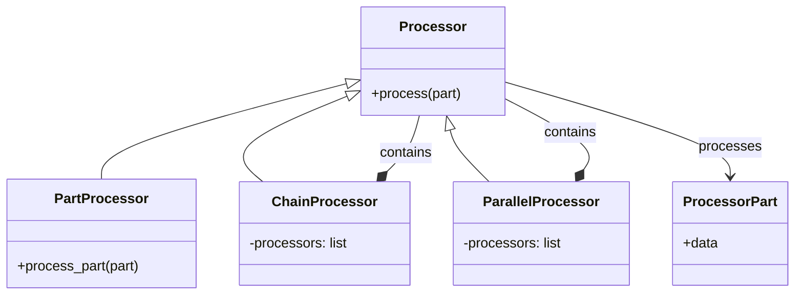

### Chaining Processors to Form Processing Pipelines

The `genai-processors` library's modularity truly shines in its ability to compose complex data flows from simpler `Processor` and `PartProcessor` units.

*   **Chaining (`+` operator)**: Processors can be chained sequentially using the `+` operator. This creates a pipeline where the output stream of one processor becomes the input stream of the next.
    *   **Internal Management**: This sequential composition is internally managed by specialized composite processors: `_ChainProcessor` for `Processor`s and `_ChainPartProcessor` for `PartProcessor`s.
    *   **Example**: `fourtimes = twotimes + twotimes` demonstrates how simple processors can be combined.
    *   **Reserved Substreams**: The `_chain_processors` function (used internally by the `+` operator) plays a crucial role in pipeline integrity. It ensures that "reserved substreams" (like debug or status information) are captured and not passed to subsequent processors in the main data flow. Instead, these special parts are siphoned off into separate queues for independent handling, preventing them from interfering with the primary content processing.

#### Processor Chaining (`+` Operator) Data Flow
This flowchart visualizes how two or more `Processor` components are chained sequentially using the `+` operator, including the role of `_ChainProcessor` and how reserved substreams are captured.

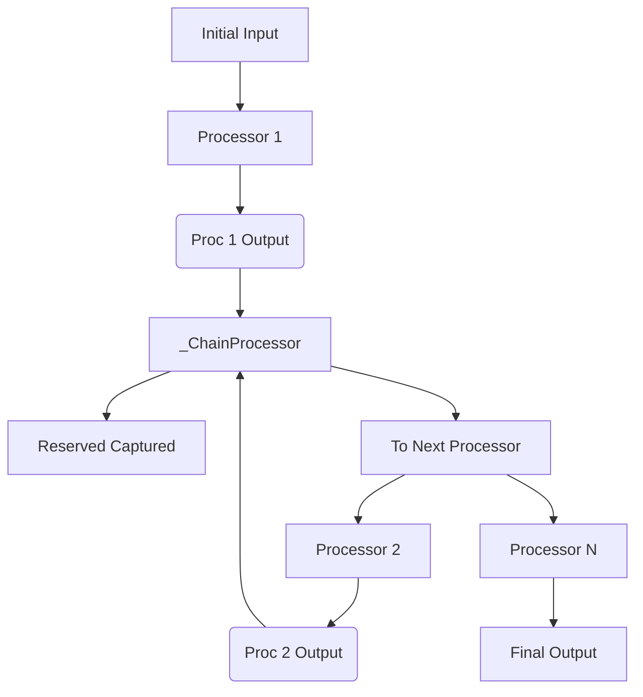

*   **Parallelization (`//` operator)**: Processors can be run in parallel using the `//` operator. This allows multiple processors to receive the *same* input stream concurrently. Their individual outputs are then concatenated into a single, unified output stream.
    *   **Internal Management**: This concurrent execution is handled by `_ParallelProcessor` for `Processor`s and `_ParallelPartProcessor` for `PartProcessor`s.
    *   **Example**: `content = processor.apply_sync(p // q, inputs)` shows how two processors `p` and `q` can process the same `inputs` concurrently.

#### Processor Parallelization (`//` Operator) Data Flow
This flowchart illustrates how multiple `Processor` components run concurrently on the same input stream using the `//` operator, and how their outputs are then concatenated into a single stream, managed by `_ParallelProcessor`.

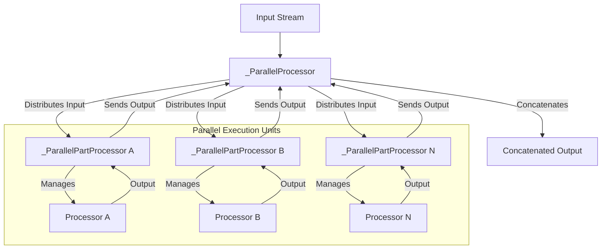

*   **Pipeline Composition**: These operators enable the creation of sophisticated pipelines. For instance, the `ResearchAgent` orchestrates a complex workflow by chaining `TopicGenerator`, `TopicResearcher`, and `TopicVerbalizer`, alongside core library processors like `GenaiModel` and `Preamble`.

### The Role of `Streams` in Managing Data Flow

Data flow in `genai-processors` is inherently stream-based, leveraging Python's `asyncio` framework for efficient asynchronous and concurrent operations. This stream-centric approach allows for real-time processing and avoids waiting for entire datasets to be loaded before processing begins.

*   **Asynchronous Iterables (`AsyncIterable`)**: The core principle is that `Processor`s consume and produce `AsyncIterable`s of `ProcessorPart`s. This means data is processed incrementally as it becomes available, rather than requiring an entire batch to be ready. This is crucial for low-latency, interactive AI applications.
*   **`stream_content`**: A utility function provided by the library to easily convert various inputs (like a single `ProcessorPart`, a list of `ProcessorPart`s, or even a simple string) into a consistent asynchronous input stream (`AsyncIterable[ProcessorPart]`).
*   **`gather_stream`**: A utility function to collect all `ProcessorPart`s from an `AsyncIterable` into a list. This effectively consumes the entire stream, useful when all results are needed before further action.
*   **`_normalize_part_stream`**: An internal function that ensures all input content to any processor is consistently converted into `ProcessorPart` objects. This guarantees a uniform data type throughout the pipeline.
*   **Stream Management Utilities**: The library provides a set of utilities for advanced stream manipulation, including splitting, concatenating, and merging asynchronous streams of `ProcessorPart`s. For example, `streams.concat` is used to combine multiple independent streams into a single, unified stream.

#### Core `genai-processors` Utility Functions
This table lists and describes key utility functions provided by the library for stream management and context handling.

| Function Name | Purpose | Category/Module |
|---|---|---|
| `stream_content` | Converts a collection of `ProcessorPart`s into an asynchronous input stream. | Stream Management |
| `gather_stream` | Collects all `ProcessorPart`s from an `AsyncIterable` into a list. | Stream Management |
| `_normalize_part_stream` | An internal function that ensures all input content is converted into `ProcessorPart` objects. | Content Normalization (Internal) |
| `streams.concat` | Combines multiple streams into one. | Stream Management |
| `create_task` | Creates `asyncio` tasks within `context_lib`. | Asynchronous Task Management / `context_lib` |

### How the `Context` Object Manages and Shares State Across a Pipeline

The `Context` object, provided by the `context_lib` module, is a critical component for managing and sharing state, particularly for pipeline-wide concerns and special data streams that need to be accessible across different processors.

*   **Asynchronous Context Manager**: The `context()` function from `context_lib` is designed as an asynchronous context manager (`async with context():`). Processors are typically applied within this context, which sets up the necessary environment for shared state and task management.
*   **`create_task`**: A utility function within `context_lib` that facilitates the creation of `asyncio` tasks. This allows for concurrent execution of operations within the pipeline's defined scope, ensuring tasks are properly managed and cleaned up.
*   **Reserved Substreams**: The `Context` mechanism is specifically used to manage "reserved substreams." These are special `substream_name` values within `ProcessorPart`s that carry meta-information or out-of-band data, rather than primary content. Examples include `PROMPT_STREAM`, `DEBUG_STREAM`, and `STATUS_STREAM`. These streams allow for pipeline-wide prompts, debug information, or status updates to be handled independently of the main data flow.
*   **`_capture_reserved_substreams`**: This internal function, used within chained processors, is key to managing reserved substreams. It identifies `ProcessorPart`s whose `substream_name` matches a reserved prefix (obtained from `context_lib.get_reserved_substreams()`). Instead of passing these parts to the next processor in the main content chain, they are siphoned off into a separate `asyncio.Queue`. This mechanism ensures that meta-data like debug logs or status updates can be collected and processed separately, preventing them from interfering with the primary data transformation logic of the pipeline.

#### Reserved Substreams in `genai-processors`
This table outlines the special `substream_name` values used within `ProcessorPart`s for managing pipeline-wide concerns like prompts, debug information, and status updates.

| Substream Name | Purpose/Usage |
|---|---|
| `PROMPT_STREAM` | Used for managing pipeline-wide prompts. |
| `DEBUG_STREAM` | Used for managing pipeline-wide debug information. |
| `STATUS_STREAM` | Used for managing pipeline-wide status updates. |

### Illustrative Pipeline Diagram: Real-Time Live Example

The `genai-processors` framework excels at building real-time, interactive AI agents. A prime example is an Audio-in Audio-out Live agent with Google Search as a tool, similar to `examples/realtime_simple_cli.py`. This pipeline demonstrates the asynchronous, streaming nature of the framework.

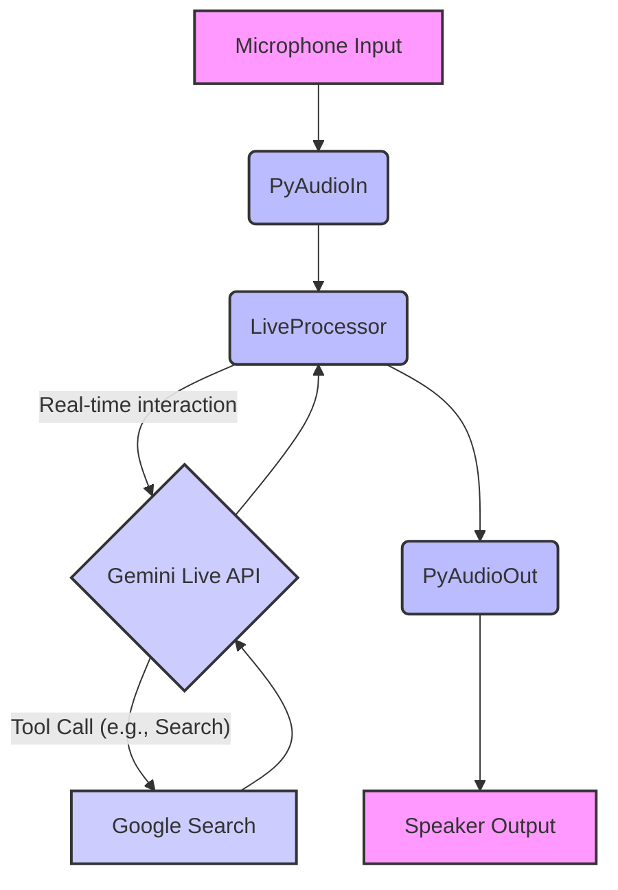

**Explanation of Data Flow:**
1.  **Microphone Input**: Raw audio data is captured from the user's microphone.
2.  **`PyAudioIn`**: This processor (`genai_processors/core/audio_io.py`) converts the raw audio stream into a sequence of `ProcessorPart`s, each containing a chunk of audio data.
3.  **`LiveProcessor`**: This core processor (`genai_processors/core/live_model.py`) takes the audio stream. It interacts with the Gemini Live API in real-time, performing operations like speech-to-text (STT) and then language model processing.
4.  **Gemini Live API & Google Search**: During its operation, the Gemini Live API, orchestrated by the `LiveProcessor`, might decide to use a tool (e.g., Google Search) to retrieve information. The results from Google Search are then fed back to the Gemini Live API for further processing.
5.  **`LiveProcessor` (continued)**: The `LiveProcessor` receives the model's response (which can include text or synthesized audio) and yields it as a stream of `ProcessorPart`s.
6.  **`PyAudioOut`**: This processor (`genai_processors/core/audio_io.py`) takes the processed `ProcessorPart`s (e.g., text-to-speech output) and plays them as audio through the system speakers.
7.  **Speaker Output**: The final audio is delivered to the user, completing the real-time interaction loop.

This example vividly demonstrates how `genai-processors` enables the creation of highly responsive, interactive AI agents through its asynchronous, streaming, and composable architecture.

## 2. Tutorial: Building Your First Command-Line Application

The `genai-processors` library simplifies the creation of command-line applications by providing a structured way to build AI pipelines. This tutorial guides you through the fundamental steps: setting up the environment, instantiating and configuring processors, composing them into a pipeline, and executing the application.

### Core GenAI Processor Class Relationships
This class diagram depicts the conceptual relationship between the `Processor` base concept, the `ProcessorPart` data unit, and how specific processors (e.g., `GenaiModel`, `TextToSpeech`) interact with or extend the `Processor` functionality.

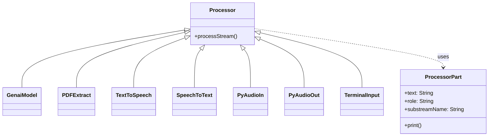

### 1. Setting Up the Python Environment and Installing Dependencies

`genai-processors` requires Python 3.10 or newer. Installation is primarily handled via `pip`.

To install the core library:
```bash
pip install genai-processors
```

For specific command-line applications, additional dependencies are required:

#### GenAI Processors Library Installation Dependencies
This table lists the `pip` commands required for installing the core library and specific dependencies for different types of command-line applications.

| Application Type | Required Libraries | Installation Command |
|------------------|--------------------|----------------------|
| Core Library | genai-processors | `pip install genai-processors` |
| Speech-to-Text CLIs | google-cloud-speech, genai-processors | `pip install --upgrade google-cloud-speech genai-processors` |
| Text-to-Speech CLIs | google-cloud-texttospeech, genai-processors | `pip install --upgrade google-cloud-texttospeech genai-processors` |
| Real-time audio agents | pyaudio, genai-processors, google-genai, termcolor | `pip install --upgrade pyaudio genai-processors google-genai termcolor` |
| PDF processing | pypdfium2 | `pip install pypdfium2` |

### 2. Importing and Instantiating Necessary Processor Classes

Building an application involves importing and creating instances of relevant processor classes. Common imports typically include:

```python
from genai_processors import content_api
from genai_processors import processor
from genai_processors import streams
from genai_processors.core import genai_model
# ... and other specific processors as needed
```

**Examples of Processor Instantiation:**

*   **For AI Generation (e.g., Gemini models):**
    ```python
    from genai_processors.core import genai_model
    # ...
    p_genai = genai_model.GenaiModel(
        model_name='gemini-2.5-flash-preview-05-20',
        api_key='YOUR_GOOGLE_API_KEY' # Replace with your actual API key or env var
    )
    ```

*   **For PDF Parsing:**
    ```python
    from genai_processors.core import pdf
    # ...
    pdf_extractor = pdf.PDFExtract()
    ```

*   **For Text-to-Speech:**
    ```python
    from genai_processors.core import text_to_speech
    # ...
    tts_processor = text_to_speech.TextToSpeech(
        project_id='YOUR_GOOGLE_PROJECT_ID' # Replace with your actual project ID
    )
    ```

*   **For Speech-to-Text:**
    ```python
    from genai_processors.core import speech_to_text
    # ...
    stt_processor = speech_to_text.SpeechToText(
        project_id='YOUR_GOOGLE_PROJECT_ID' # Replace with your actual project ID
    )
    ```

*   **For Terminal Input/Output (Audio & Text):**
    ```python
    from genai_processors.core import audio_io
    from genai_processors.core import text
    import pyaudio
    # ...
    pya = pyaudio.PyAudio() # Required for PyAudioIn/Out
    input_audio_processor = audio_io.PyAudioIn(pya)
    output_audio_processor = audio_io.PyAudioOut(pya)
    terminal_text_input_source = text.terminal_input('message > ')
    ```

#### Common GenAI Processor Classes and Instantiation Examples
This table provides a quick reference for frequently used processor classes, their purpose, and basic Python instantiation code snippets.

| Processor Class | Purpose/Description | Example Instantiation |
|-----------------|---------------------|-----------------------|
| GenaiModel | For AI Generation (e.g., Gemini models) | `GenaiModel(model_name='gemini-2.5-flash-preview-05-20', api_key=GOOGLE_API_KEY)` |
| PDFExtract | For PDF Parsing | `pdf.PDFExtract()` |
| TextToSpeech | For Text-to-Speech | `text_to_speech.TextToSpeech(project_id=GOOGLE_PROJECT_ID)` |
| SpeechToText | For Speech-to-Text | `speech_to_text.SpeechToText(project_id=GOOGLE_PROJECT_ID)` |
| PyAudioIn | For Terminal Audio Input | `audio_io.PyAudioIn(pya)` |
| PyAudioOut | For Terminal Audio Output | `audio_io.PyAudioOut(pya)` |
| terminal_input | For Terminal Text Input | `text.terminal_input('message > ')` |

### 3. Configuring Processors with Necessary Parameters

Processors are configured by passing arguments to their constructors. These parameters control their behavior, connect them to external services, and define their processing logic.

*   **API Keys and Project IDs:**
    Sensitive credentials are best managed via environment variables.
    ```python
    import os
    API_KEY = os.environ.get('GOOGLE_API_KEY')
    GOOGLE_PROJECT_ID = os.environ.get('GOOGLE_PROJECT_ID')
    # Ensure these are set in your environment before running
    if not API_KEY or not GOOGLE_PROJECT_ID:
        raise ValueError("GOOGLE_API_KEY and GOOGLE_PROJECT_ID environment variables must be set.")
    ```

*   **`GenaiModel` Configuration:**
    The `GenaiModel` processor offers extensive configuration for interacting with Google's Generative AI models.
    *   `api_key`: Required for authentication.
    *   `model_name`: Specifies the particular AI model (e.g., `'gemini-2.5-flash-preview-05-20'`). Can also be configured dynamically from a `Config` object.
    *   `generate_content_config`: A dictionary defining how the model should generate content. This includes:
        *   `response_mime_type`: Desired output format (e.g., `'application/json'`).
        *   `response_schema`: A Pydantic schema or similar structure for enforcing structured JSON output.
        *   `system_instruction`: A preamble to guide the model's behavior.
    *   `tools`: A list of tools the model can use (e.g., `genai_types.Tool(google_search=genai_types.GoogleSearch())` to enable Google Search).
    *   `http_options`: Configures underlying HTTP client behavior, including `api_version` and `retry_options`.

#### GenaiModel Configuration Parameters
This table details the key parameters used to configure the `GenaiModel` processor, including their purpose and example values or sources.

| Parameter | Description | Example Value/Source |
|---|---|---|
| `api_key` | API key for authentication with the GenAI service. | `API_KEY` |
| `model_name` | Specifies the AI model to be used. | `'gemini-2.5-flash-preview-05-20'` |
| `generate_content_config` | Defines the expected response format and schema from the AI model. | `{'response_mime_type': 'application/json', 'response_schema': list[interfaces.Topic]}` |
| `tools` | Enables AI model capabilities such as Google Search. | `[genai_types.Tool(google_search=genai_types.GoogleSearch())]` |
| `http_options` | Configures HTTP behavior for requests, including API version and retry options. | Includes `api_version` and `retry_options` |

*   **`TextToSpeech` Configuration:**
    *   `project_id`: Required for Google Cloud Text-to-Speech API.
    *   `language_code`, `voice_name`, `with_text_passthrough`: Optional parameters to fine-tune speech synthesis.

#### TextToSpeech Processor Configuration Parameters
This table lists and describes the parameters available for configuring the `TextToSpeech` processor.

| Parameter | Description | Example Value/Notes |
|---|---|---|
| `project_id` | The Google Cloud project ID used for Text-to-Speech API calls. | `GOOGLE_PROJECT_ID` (Replace with your actual project ID) |
| `language_code` | Optional. Specifies the language and region for speech synthesis. | e.g., `en-US`, `es-ES` |
| `voice_name` | Optional. Specifies the particular voice to use for speech synthesis. | e.g., `en-US-Wavenet-D`, `es-ES-Neural2-A` |
| `with_text_passthrough` | Optional. If true, the original input text is returned alongside the synthesized audio. | Boolean: `true` or `false` |

*   **`SpeechToText` Configuration:**
    *   `project_id`: Required for Google Cloud Speech-to-Text API.
    *   `recognition_config`: Defines audio properties (e.g., `sample_rate_hertz`, `encoding`, `language_codes`).
    *   `with_endpointing`, `strict_endpointing`, `with_interim_results`: Control transcription behavior and output streams for real-time applications.

*   **`Preamble` and `Suffix` Processors:**
    These processors add fixed content to the stream, typically for providing context or instructions to subsequent AI models. They are configured with `content`, which can be a string or a list of `ProcessorPart`s.
    ```python
    from genai_processors.core import preamble
    p_preamble = preamble.Preamble(
        content='You are an expert assistant. Respond concisely.'
    )
    ```

### 4. Linking Processors Together to Form a Sequential Pipeline

The `genai-processors` library provides intuitive operators for composing processors into pipelines.

*   **Chaining (`+` operator):** Processors are linked sequentially using the `+` operator. The output stream of one processor becomes the input stream of the next, creating a linear data flow.
    ```python
    # Example: PDF extraction -> Preamble -> GenAI Model
    pipeline = (
        pdf_extractor + p_preamble + p_genai
    )
    ```

#### GenAI Processor Pipeline Data Flow
This flowchart illustrates the high-level data flow through a typical GenAI Processors pipeline, from an asynchronous input stream of `ProcessorPart`s, through chained or parallel processors, to an asynchronous output stream of `ProcessorPart`s.

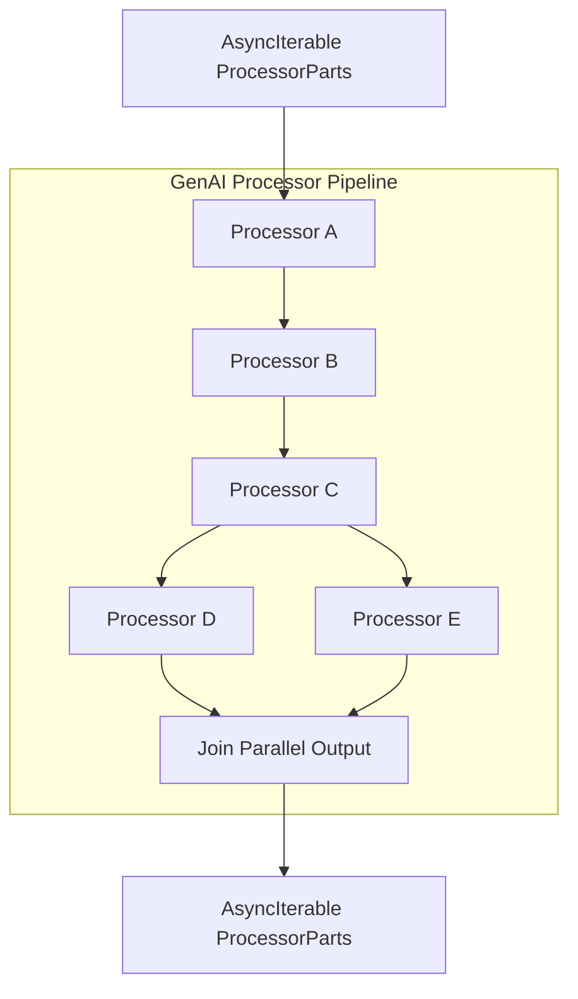

    A more complex example for a real-time conversational agent might involve nested pipelines:
    ```python
    from genai_processors.core import realtime
    # Assuming input_processor (audio_in + speech_to_text) and play_output (audio_out) are defined
    # And genai_processor (GenaiModel) and tts (TextToSpeech) are defined
    turn_processor = genai_processor + tts
    conversation_agent = (
        input_processor
        + realtime.LiveModelProcessor(turn_processor=turn_processor)
        + play_output
    )
    ```

#### Real-time Conversational Agent Pipeline Example
This flowchart visualizes the specific sequential pipeline for a real-time conversational agent, showing the flow from audio input to speech-to-text, through a live model processor (which internally handles GenAI and text-to-speech), and finally to audio output.

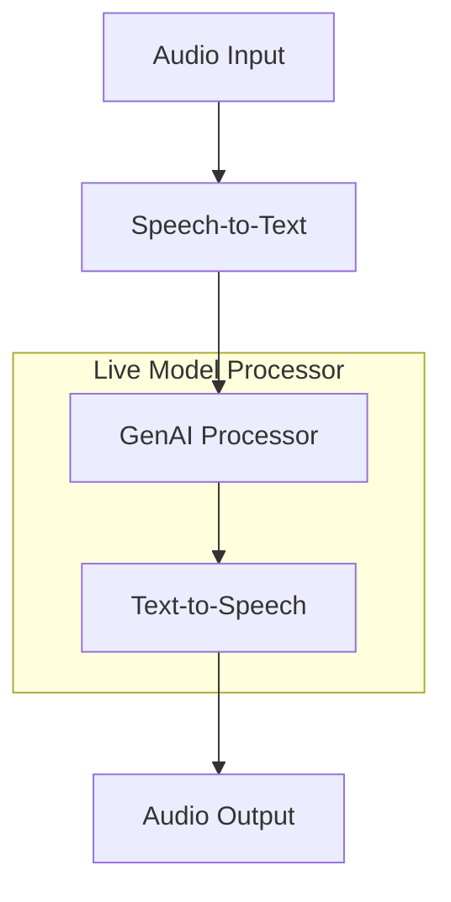

*   **Parallelization (`//` operator):** Processors can also be run in parallel using the `//` operator. This is useful when the same input needs to be processed by multiple independent branches, and their results are then combined.

### 5. Executing the Final Script and Handling its Input and Output

Command-line applications built with `genai-processors` are typically executed as Python scripts and handle input/output asynchronously.

#### CLI Application Asynchronous Execution Flow
This sequence diagram illustrates the sequence of interactions and control flow from a user executing a Python CLI script to the asynchronous processing of input, execution of the GenAI pipeline, and handling of output.

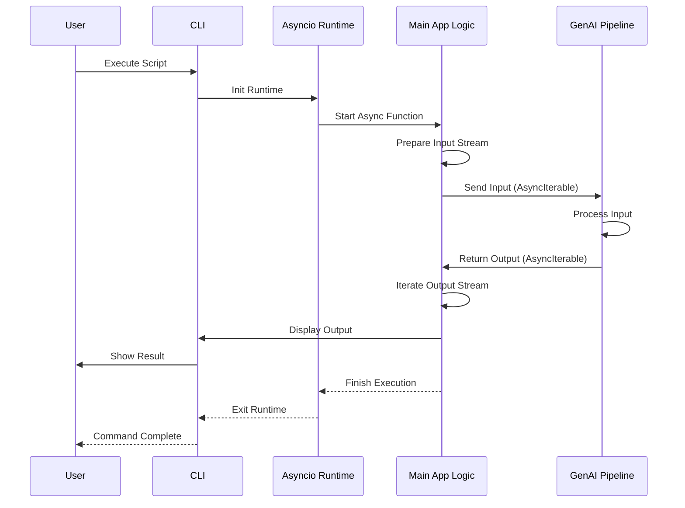

*   **Execution Command:**
    Run your Python script from the terminal:
    ```bash
    python3 your_app.py
    ```

*   **Input Handling:**
    *   **Asynchronous Execution:** The main application logic should be an `async` function, executed using `asyncio.run()`.
        ```python
        import asyncio
        async def main_app_logic():
            # ... pipeline definition and execution ...
            pass
        if __name__ == '__main__':
            asyncio.run(main_app_logic())
        ```
    *   **Creating Input Streams:** Input to a pipeline must be an `AsyncIterable` of `ProcessorPart`s.
        *   For simple string inputs or structured data, use `processor.stream_content()`:
            ```python
            from genai_processors import processor, content_api
            # For a simple text input
            input_stream = processor.stream_content(["Hello, GenAI Processors!"])
            # For a structured request (e.g., for a DriveProcessor)
            # req_part = content_api.ProcessorPart.from_dataclass(dataclass=my_request_dataclass)
            # input_stream = processor.stream_content([req_part])
            ```
        *   For terminal text input, `text.terminal_input()` acts as a source processor:
            ```python
            from genai_processors.core import text
            # This processor will yield parts from user input in the terminal
            user_input_stream = text.terminal_input('Your message: ')
            ```
        *   For audio input from a microphone, `audio_io.PyAudioIn()` captures data:
            ```python
            from genai_processors.core import audio_io
            import pyaudio
            pya = pyaudio.PyAudio()
            mic_input_stream = audio_io.PyAudioIn(pya)
            ```

*   **Output Handling:**
    *   **Asynchronous Iteration:** The output of a pipeline is an `AsyncIterable` of `ProcessorPart`s. Iterate over it using `async for` to process results as they become available.
        ```python
        async for content_part in pipeline(input_stream):
            # Process each part
            if content_part.text:
                print(f"Received text: {content_part.text}")
            # Check mimetype for other content types
            if content_part.is_audio():
                print("Received audio part.")
        ```
    *   **Formatted Output:** `ProcessorPart` objects can be printed directly, or their attributes (like `text`, `role`, `substream_name`) can be accessed for custom formatting. Libraries like `termcolor` can enhance readability.
        ```python
        import termcolor
        async for part in pipeline(input_stream):
            color = 'cyan'
            if part.role == 'user':
                color = 'green'
            elif part.role == 'model':
                color = 'red'
            
            if part.text:
                print(termcolor.colored(f"{part.role or 'system'}: {part.text}", color))
        ```
    *   **Audio Output:** `audio_io.PyAudioOut()` sends audio `ProcessorPart`s to system speakers.
        ```python
        # Assuming tts_processor outputs audio parts
        audio_pipeline = tts_processor + audio_io.PyAudioOut(pya)
        async for _ in audio_pipeline(text_input_stream):
            pass # Audio is played by PyAudioOut, no explicit print needed
        ```

## 3. Integrating with Generative AI Models: Google GenAI and Ollama

The `genai-processors` library provides a flexible and unified approach to integrating with various Generative AI models, whether they are cloud-based services like Google's GenAI or local models served via Ollama. This section details how the common `Processor` interface enables this integration and how specific model providers are configured.

### Common Interface for Interacting with Different Models

The core principle behind `genai-processors`'s model integration is the `Processor` abstraction. This provides a consistent and unified interface for all units of work, including those that encapsulate interactions with large language models (LLMs).

A `Processor` is fundamentally defined by its asynchronous `call` method:
```python
# Any class inheriting from processor.Processor and
# implementing this function is a processor.
async def call(
  content: AsyncIterable[ProcessorPart]
) -> AsyncIterable[ProcessorPartTypes]
```
This means any model wrapper, regardless of the underlying API, adheres to this input/output signature, processing an asynchronous stream of `ProcessorPart` objects and returning a new stream of `ProcessorPart`s.

#### Core `Processor` Interface and Content Handling
This class diagram illustrates the fundamental `Processor` abstraction, its `call` method, and the `ProcessorPart` and `ProcessorPartTypes` involved in content flow.

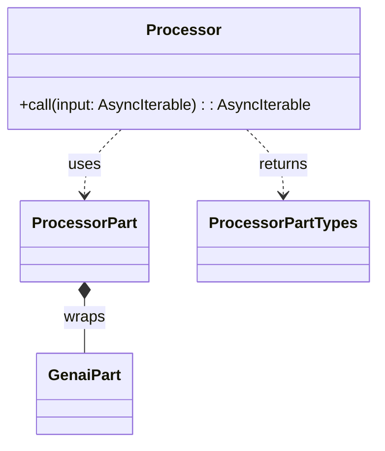

#### GenAI Processors `Processor` Interface Summary
This table summarizes the key aspects of the `Processor` interface, its input, output, and core capabilities.

| Concept | Key Method | Input Type | Output Type | Core Capabilities |
|---------|------------|------------|-------------|-------------------|
| Fundamental abstraction for any unit of work within the GenAI Processors library. | asynchronous `call` method | asynchronous iterable of `ProcessorPart` objects | asynchronous iterable of `ProcessorPartTypes` | Unified interface for turn-based and real-time streaming; enables chaining (`+`) and parallelizing (`//`) processors. |

This common interface is crucial because it allows for seamless [chaining](#chaining-processors-to-form-processing-pipelines) (`+` operator) and [parallelizing](#chaining-processors-to-form-processing-pipelines) (`//` operator) of different processors, including those that perform LLM interactions. This enables the creation of complex data flows and sophisticated agentic behaviors. The `ProcessorPart` objects are central to this content handling, acting as versatile containers that wrap `genai.types.Part` and support diverse content types like text, images, audio, and custom JSON.

#### GenAI Processors Pipeline Data Flow
This flowchart depicts how `Processor` instances process asynchronous iterables of `ProcessorPart` objects, and how multiple processors can be chained or parallelized to form complex AI pipelines.

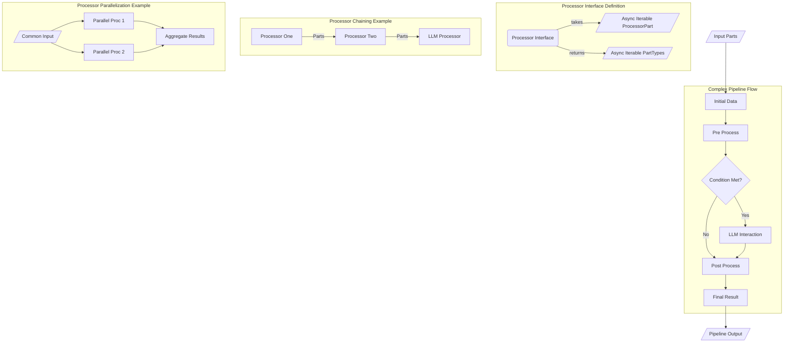

### Configuring Credentials and Selecting a Model for `GenAIModelProcessor`

The `genai_model.GenaiModel` processor is designed for standard, turn-based interactions with Google's Generative AI models (e.g., Gemini). Its configuration is crucial for specifying the model, authentication, and desired output behavior.

To configure and select a model for `GenaiModel`, the following parameters are used during its initialization:

*   **`api_key`**: A string representing the API key for authentication with the Gemini Developer API. This should ideally be loaded from a secure environment variable.
*   **`model_name`**: A string specifying the name of the model to use. The library supports various formats for both Vertex AI API and Gemini API models, providing flexibility in model selection.
*   **`generate_content_config`**: An optional dictionary for advanced content generation parameters. This includes settings like `system_instruction` (a preamble to guide the model), `response_mime_type` (e.g., `application/json` for structured output), and `response_schema` (a schema definition for structured JSON).
*   **`http_options`**: Optional HTTP client configuration options, such as `api_version` and `retry_options`, to control the network behavior of requests.

#### `GenAIModelProcessor` Initialization Parameters
This table lists and describes the configuration parameters used when initializing a `GenAIModel` for interacting with Google's GenAI models.

| Parameter | Type | Description | Example Value/Usage |
|---|---|---|---|
| api_key | string | A string representing the API key for authentication with Google's GenAI models. | `"YOUR_API_KEY"` or `os.getenv("GEMINI_API_KEY")` |
| model_name | string | A string specifying the name of the GenAI model to use. | `"gemini-pro"`, `"gemini-1.5-flash"`, `"gemini-1.5-pro"` |
| generate_content_config | Optional configuration object | Optional configuration parameters for controlling content generation behavior, such as temperature or maximum output tokens. | `{"temperature": 0.7, "max_output_tokens": 1024}` |
| http_options | Optional HTTP options object | Optional HTTP client configuration options, such as timeout settings. | `{"timeout": 60}` |

#### Google GenAI `model_name` Formats
This table details the various supported formats for specifying model names when using `GenAIModelProcessor` for both Vertex AI and Gemini API models.

| API Type | Format Description | Example Model Names |
|---|---|---|
| Vertex AI API | Gemini model IDs | 'gemini-2.0-flash' |
| Vertex AI API | Full resource names starting with 'projects/' | 'projects/your-project/locations/us-central1/publishers/google/models/gemini-pro' |
| Vertex AI API | Partial resource names with 'publishers/' | 'publishers/google/models/gemini-pro' |
| Vertex AI API | 'publisher/model-name' format | 'google/gemini-pro' |
| Gemini API | Gemini model IDs | 'gemini-2.0-flash' |
| Gemini API | Model names starting with 'models/' | 'models/gemini-pro' |
| Gemini API | Tuned model names starting with 'tunedModels/' | 'tunedModels/my-tuned-model-id' |

**Example:**
```python
import os
from genai_processors.core import genai_model
from genai import types as genai_types

# Assuming API_KEY and TripRequest are defined
p_travel_agent = genai_model.GenaiModel(
    api_key=os.environ.get('GEMINI_API_KEY'),
    model_name='gemini-2.0-flash-lite',
    generate_content_config=genai_types.GenerateContentConfig(
        system_instruction=(
            'You are a travel agent. You are given a trip request from a user.'
            'Your task is to parse the request into a structured JSON format.'
        ),
        response_mime_type='application/json',
        # response_schema=TripRequest.json_schema(), # Assuming TripRequest is a dataclass
    ),
)
```

### Connecting to a Local Ollama Instance using `OllamaModelProcessor`

The `ollama_model.py` module within `genai-processors` provides an `OllamaModelProcessor` that wraps the Ollama API, enabling the use of locally-run LLMs (e.g., Gemma, Llama 3) within your pipelines.

The steps to connect to a local Ollama instance are:

1.  **Install Ollama**: First, ensure Ollama is installed on your system.
    ```sh
    curl -fsSL https://ollama.com/install.sh | sh
    ```
2.  **Pull the desired model**: After installing Ollama, download the specific model you intend to use (e.g., Gemma).
    ```sh
    ollama pull gemma3
    ```

#### Ollama Local Setup and Integration Workflow
This flowchart outlines the sequential steps required to set up a local Ollama instance and integrate it with the `OllamaModelProcessor` for local LLM usage.

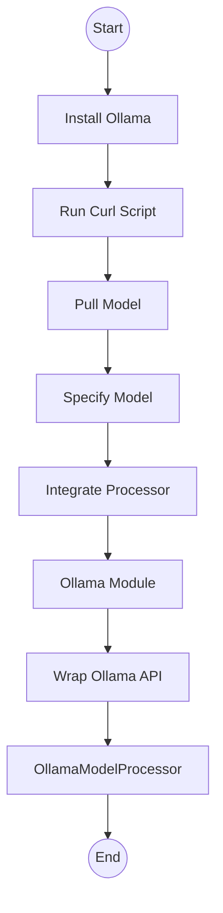

The `ollama_model` processor, by default, connects to a local Ollama server running at `http://127.0.0.1:11434`.

#### OllamaModelProcessor to Local Ollama API Interaction
This sequence diagram shows the communication flow when `OllamaModelProcessor` sends a request to a local Ollama instance, including the default endpoint and payload details.

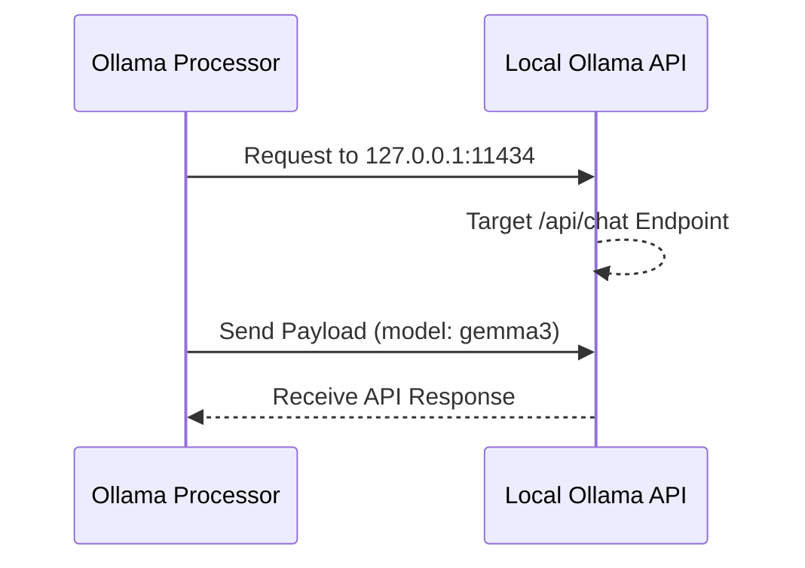

Configuration parameters for `OllamaModelProcessor`, such as `system_instruction`, `response_mime_type`, `response_schema`, and `response_json_schema`, can be provided via a `GenerateContentConfig` dictionary, similar to `GenaiModel`. This allows for structured output and fine-grained control over the local LLM's behavior.

#### `OllamaModelProcessor` Configuration and Defaults
This table summarizes the default connection settings and configurable parameters for the `OllamaModelProcessor`.

| Configuration Item | Description | Default/Type |
|---|---|---|
| Ollama API Endpoint | The default URL for the Ollama API server that the processor connects to. | `http://127.0.0.1:11434` (string) |
| system_instruction | An instruction provided to the model at the beginning of the conversation, influencing its behavior or persona. | `None` (string, configurable via `GenerateContentConfig`) |
| response_mime_type | Specifies the desired MIME type for the model's response, enabling structured output (e.g., `application/json`). | `None` (string, configurable via `GenerateContentConfig`) |
| response_schema | Defines a structured schema for the model's output, guiding the response format. | `None` (dictionary/object, configurable via `GenerateContentConfig`) |
| response_json_schema | Defines a JSON schema for the model's output when a JSON response is desired. | `None` (dictionary/object, configurable via `GenerateContentConfig`) |

### Purpose of `LiveModel` and its Difference from a Standard Model Processor

The `genai-processors` library provides two distinct processors for handling "live" or real-time interactions, each serving a different purpose:

1.  **`live_model.LiveProcessor`**: This processor is designed for direct, real-time, streaming interactions with **Google's GenAI Live API**. It is used with models specifically optimized for live interaction, often indicated by a `-live-` suffix (e.g., `gemini-2.0-flash-live-001`). This processor manages the real-time session, sending and receiving continuous streams of data (audio, text, tool responses) and handling configurations specific to live interactions (e.g., `system_instruction`, `tools`, `output_audio_transcription`, `enable_affective_dialog`, `response_modalities`). It directly leverages the low-latency features of the Gemini Live API.

2.  **`realtime.LiveModelProcessor`**: This processor serves as an **adapter** that converts a *turn-based model* (like `genai_model.GenaiModel`) into a real-time, "live" behaving processor. It achieves this by taking an infinite input stream and maintaining a "rolling" (sliding) prompt. This rolling prompt is continuously fed to the underlying turn-based `turn_processor`. The response from the `turn_processor` is then added back to the rolling prompt for subsequent turns, simulating a continuous conversation. This is particularly useful for orchestrating standard text-based LLMs in real-time audio-in/audio-out scenarios, even if the underlying LLM isn't inherently a "live" model.

#### `Realtime.LiveModelProcessor` Adaptation Mechanism
This flowchart illustrates how `realtime.LiveModelProcessor` adapts a turn-based model for real-time interactions by managing an infinite input stream, a rolling prompt, and feeding it to an underlying turn-based processor.

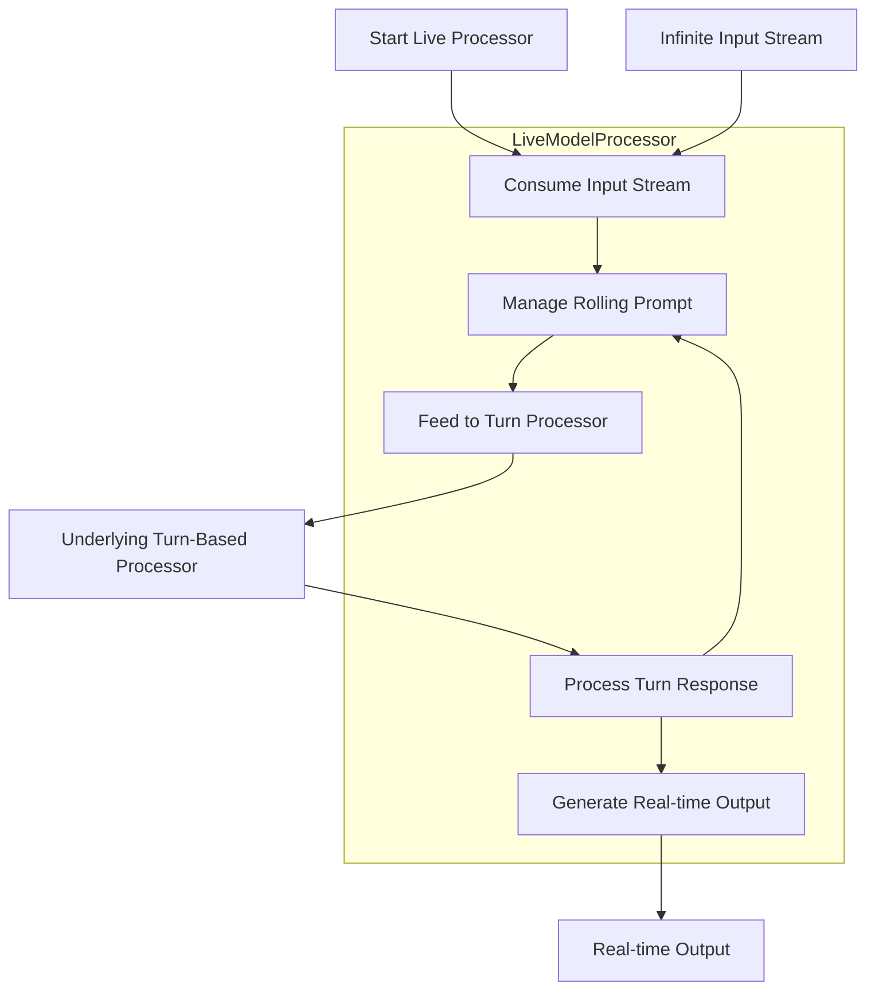

In summary, `live_model.LiveProcessor` is for direct integration with the dedicated GenAI Live API, leveraging its native real-time capabilities. In contrast, `realtime.LiveModelProcessor` is a wrapper that adapts any standard, turn-based `Processor` to simulate live agent behavior, providing flexibility for various LLMs.

### Approach to Extend the Library to Support a New Model Provider (e.g., Anthropic Claude)

Extending the `genai-processors` library to support a new model provider like Anthropic Claude is a straightforward process, thanks to its modular `Processor` interface. The general approach involves creating a custom `Processor` that adheres to the library's core conventions.

The general approach would be:

1.  **Create a New Processor Class**: Define a new Python class that inherits directly from `processor.Processor`. This establishes it as a fundamental unit of work within the framework.
2.  **Implement the `call` Method**: The new class must implement the `async def call(content: AsyncIterable[ProcessorPart]) -> AsyncIterable[ProcessorPartTypes]` method. This is where the core logic for interacting with the new model provider will reside.
3.  **Integrate with the New Provider's API**:
    *   Within the `call` method (or during the processor's initialization), handle the specifics of authenticating with the new model provider's API (e.g., Anthropic Claude's API key management).
    *   Convert incoming `ProcessorPart` content into the format expected by the new provider's API. This might involve extracting text, image bytes, or structured data from the `ProcessorPart` and mapping it to the provider's request format. The `ollama_model.py` serves as an excellent example of how to wrap an external API (Ollama) by handling HTTP requests and content conversion.
    *   Process the responses received from the new provider's API.
    *   Convert these responses back into `ProcessorPart` objects, ensuring they are properly formatted with relevant MIME types, roles, and any necessary metadata, before yielding them as the output stream.
4.  **Contribution Guidelines**: If you wish to contribute your new processor to the `genai-processors` community, it should be placed under the `genai_processors/contrib/` folder, following the established contribution guidelines.

#### Extending GenAI Processors for a New Model Provider
This flowchart presents the step-by-step process for adding support for a new model provider (e.g., Anthropic Claude) by creating a custom `Processor`.

```mermaid
graph TD
    Start[Begin]
    Create_Class[Create Processor Class]
    Implement_Call[Implement call() Method]
    Integrate_API[Integrate Provider API]
    Convert_Input[Convert Input Parts]
    Process_Response[Process Provider Response]
    Convert_Output[Convert Output Parts]
    End[End]

    Start --> Create_Class
    Create_Class --> Implement_Call
    Implement_Call --> Integrate_API
    Integrate_API --> Convert_Input
    Convert_Input --> Process_Response
    Process_Response --> Convert_Output
    Convert_Output --> End
```

## 4. Real-time Audio and Speech Processing

The `genai-processors` library provides robust capabilities for building real-time audio and speech applications, leveraging its modular and asynchronous design. This section delves into how audio streams are managed, processed for Speech-to-Text (STT) and Text-to-Speech (TTS), and orchestrated for low-latency, bidirectional interactions.

### 1. How is an audio input stream captured and chunked for processing?

Audio input streams are captured and prepared for processing using the `PyAudioIn` processor, located in `genai_processors/core/audio_io.py`. This processor acts as a source, continuously capturing audio from the local machine's default microphone.

*   **Initialization**: The `PyAudioIn` processor initializes an audio stream using the `pyaudio` library. It configures the stream with specific parameters such as audio `format` (e.g., `pyaudio.paInt16` for 16-bit PCM), number of `channels` (e.g., 1 for mono), and `rate` (e.g., 24000 Hz).
*   **Chunking**: Audio is captured in small, manageable chunks. The processor repeatedly calls `audio_stream.read()` to fetch `AUDIO_OUT_CHUNK_SIZE` (1024 bytes) of raw audio data within an asynchronous loop.
*   **Encapsulation**: Each captured audio chunk is immediately encapsulated into a `ProcessorPart` object. This `ProcessorPart` is enriched with metadata:
    *   `mimetype`: Set to indicate the audio format and rate (e.g., `audio/l16;rate=24000`).
    *   `substream_name`: Typically set to `'realtime'` to identify it as a live audio stream.
    *   `role`: Set to `'USER'` to denote the origin of the audio.
*   **Streaming**: These `ProcessorPart`s are then asynchronously yielded into the pipeline's input stream, allowing subsequent processors (like Speech-to-Text) to begin processing the audio as it arrives, without waiting for the entire input to be buffered.

#### Audio Input Stream Capture and Chunking Process
This flowchart illustrates the step-by-step process of how audio is captured from the microphone, chunked, and encapsulated into `ProcessorPart` objects by the `PyAudioIn` processor.

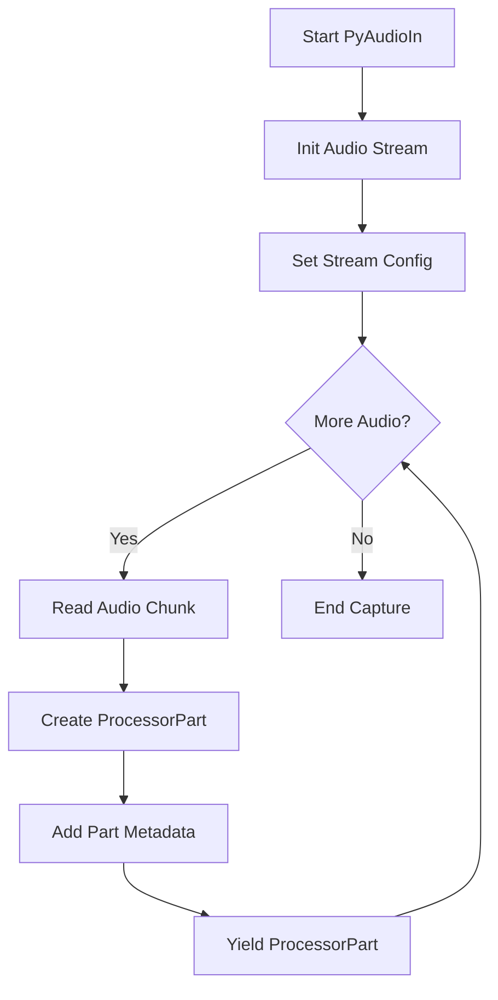

### 2. What are the underlying services or libraries used for STT and TTS?

*   **Speech-to-Text (STT):**
    The `SpeechToText` processor (`genai_processors/core/speech_to_text.py`) explicitly relies on the **Google Cloud Speech API**. It uses the `google-cloud-speech` library for interaction, configuring recognition parameters via `speech_v2.types.RecognitionConfig`. This allows for high-accuracy, real-time transcription of audio streams.

*   **Text-to-Speech (TTS):**
    While not explicitly detailed in the provided snippets, the `TextToSpeech` processor (`genai_processors/core/text_to_speech.py`) is used in examples (`examples/realtime_simple_cli.py`, `examples/text_to_speech_cli.py`) in a manner analogous to `SpeechToText`. This strongly implies that it leverages the **Google Cloud Text-to-Speech API** for synthesizing natural-sounding speech from text.

#### Core GenAI Processors Capabilities Summary
This table summarizes the main audio and speech processing components within the GenAI Processors library, detailing their primary functions, key features, and underlying technologies.

| Processor Name | Primary Function | Key Features / Underlying Technology | Input Type | Output Type |
|---|---|---|---|---|
| PyAudioIn | Audio capture and chunking from input devices | Uses `pyaudio` library, outputs `ProcessorPart` | Raw audio stream (microphone) | Audio chunks |
| SpeechToText | Converts spoken audio into text (STT) | Google Cloud Speech API, `google-cloud-speech`, `speech_v2.types.RecognitionConfig` | Audio (chunks) | Text (transcribed speech) |
| TextToSpeech | Converts text into spoken audio (TTS) | Implied Google Cloud Text-to-Speech API | Text | Audio (synthesized speech) |
| LiveModelProcessor / LiveProcessor | Orchestrates bidirectional interaction with GenAI models | `asyncio` for asynchronous operations, integrates Gemini Live API features | Various (e.g., audio chunks, text commands) | Various (e.g., text responses, audio streams) |
| RateLimitAudio | Controls real-time audio playback rate and handles interruptions | Manages audio buffering and splitting for smooth playback | Audio (e.g., from TTS) | Rate-controlled audio chunks |
| PyAudioOut | Plays back audio to output devices | Uses `pyaudio` library | Audio chunks | Raw audio stream (speaker) |

### 3. How does the `realtime.py` module facilitate low-latency, bidirectional interactions?

The `realtime.py` module, specifically through the `realtime.LiveModelProcessor` (which often wraps `genai_processors.core.live_model.LiveProcessor`), is instrumental in transforming text-based LLMs into "Live agents" capable of streaming and orchestration, enabling low-latency, bidirectional interactions.

The `LiveProcessor` facilitates this by:

*   **Streaming Input**: It continuously sends "realtime input" to the underlying model (e.g., Gemini Live API). This input can include both media (audio, video) and text, allowing for a continuous flow of user data. This is achieved via methods like `session.send_realtime_input()`.
*   **Streaming Output**: Concurrently, it continuously receives responses from the model via `session.receive()`. These responses are processed and yielded as `ProcessorPart`s, ensuring that model output is available as soon as it's generated.
*   **Asynchronous Processing**: The entire `genai-processors` library is built on Python's `asyncio` framework. This foundation is critical for enabling non-blocking, concurrent operations, which are essential for maintaining low latency in real-time interactions.
*   **Underlying API Features (Gemini Live API)**: The `LiveProcessor` leverages specific features of the Gemini Live API that are designed for low latency:
    *   **Voice Activity Detection (VAD)**: Built into the API, VAD detects when the user starts speaking. This allows for immediate interruption of the model's ongoing output, enabling natural turn-taking in conversations.
    *   **Asynchronous Function Calls**: The Gemini API supports non-blocking function calls. This enables the model to schedule future actions (e.g., generating the next part of a comment) without interrupting its current utterance. This leads to a more fluid and responsive conversational experience.

The `LiveModelProcessor` acts as an orchestrator, managing the concurrent input and output streams, thus enabling a continuous and highly responsive conversational flow.

#### Bidirectional Interaction via LiveProcessor
This sequence diagram illustrates the asynchronous communication flow between the `LiveProcessor` (or `LiveModelProcessor`) and the underlying model/API (e.g., Gemini Live API) for continuous input and output streaming, highlighting key API calls and features.

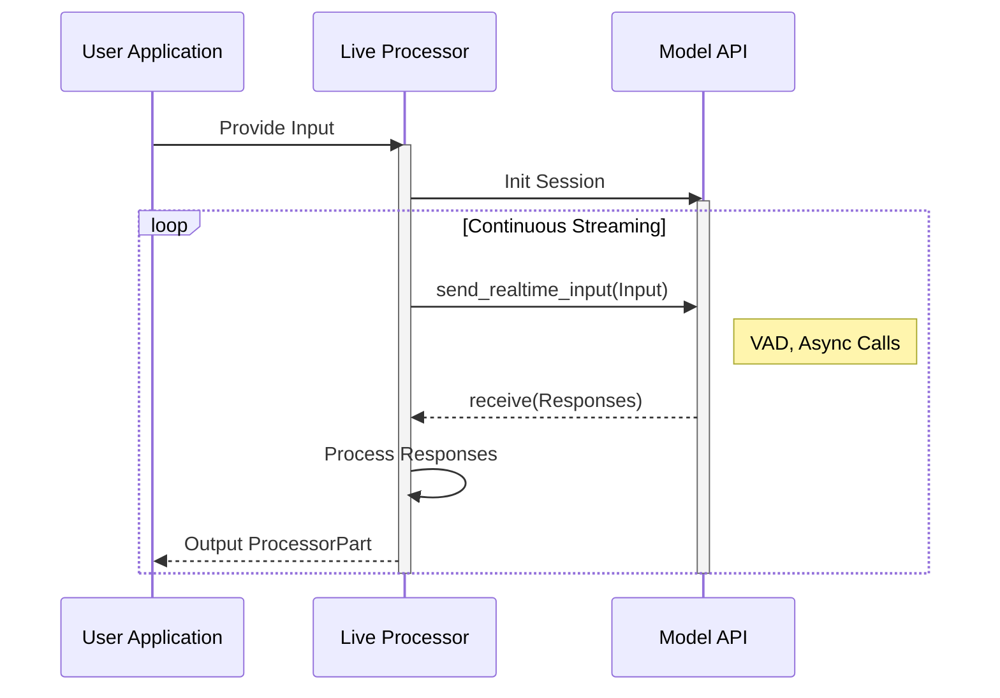

#### Gemini Live API Features for Low-Latency Interaction
This table details the specific features of the Gemini Live API that are leveraged by the `LiveProcessor` to enable a highly responsive and natural real-time conversational experience.

| Feature | Description | Benefit for Low Latency |
|---|---|---|
| Voice Activity Detection (VAD) | Built into the API, VAD detects when the user is speaking. | Enables immediate interruption of model output, facilitating quick turn-taking and a highly responsive conversation. |
| Asynchronous Function Calls | The Gemini API supports non-blocking function calls, allowing the model to schedule future actions (like generating the next comment) without interrupting the current utterance. | Enables the model to pre-emptively prepare responses or actions in the background, leading to a more natural, fluid, and responsive conversational flow without perceived delays. |

### 4. What is the function of the `RateLimitAudio` processor in managing audio streams?

The `RateLimitAudio` processor (`genai_processors/core/rate_limit_audio.py`) plays a critical role in managing streaming audio output, ensuring a natural playback experience and robust interruption handling in real-time applications.

Its primary functions are:

*   **Real-time Playback Rate Control:** It "splits and rate-limits audio streams to ensure natural playback speed." This means it takes incoming audio `ProcessorPart`s (e.g., from a TTS model) and yields them in smaller chunks at a controlled rate, matching the real-time speed at which they should be played. It achieves this by introducing calculated delays (`await self._asyncio_sleep(sleep_sec)`) between yielding parts, preventing audio from playing too fast or too slow.
*   **Interruption Handling:** A key feature for interactive agents, `RateLimitAudio` is designed to "stop the audio when the user is speaking." If an incoming `ProcessorPart` contains `interrupted` metadata (signaling user speech detected by VAD), the processor immediately flushes its internal audio queue, effectively stopping any ongoing audio playback. This allows for dynamic conversational turns where the model's speech can be preempted by the user.
*   **Buffering and Splitting:** It buffers incoming audio parts to ensure a smooth flow. Additionally, it can split large audio chunks into smaller sub-parts if they exceed a predefined duration (`2 * MAX_AUDIO_PART_SEC`). This ensures that audio is streamed in manageable segments, which is beneficial for both real-time processing and interruption responsiveness.

#### `RateLimitAudio` Processor Functionality
This table outlines the specific responsibilities and mechanisms of the `RateLimitAudio` processor in managing streaming audio output to ensure natural playback speed and handle interruptions.

| Function | Mechanism / Description | Impact on Audio Stream |
|---|---|---|
| Real-time Playback Rate Control | Splits and rate-limits audio streams to ensure natural playback speed; uses `await self._asyncio_sleep(sleep_sec)` for timing. | Ensures natural and consistent playback speed of streaming audio. |
| Interruption Handling | Designed to stop audio when the user is speaking. When an incoming `ProcessorPart` has `interrupted` metadata, it immediately flushes the audio queue. | Halts current audio playback instantly to accommodate user input or new audio. |
| Buffering and Splitting | Buffers incoming audio parts. Can split large audio chunks into smaller sub-parts if they exceed `2 * MAX_AUDIO_PART_SEC` duration. | Manages audio flow by preparing and segmenting data for smoother processing and playback. |

### 5. Walk through the code of `realtime_simple_cli.py` to explain a complete STT -> LLM -> TTS loop.

The `examples/realtime_simple_cli.py` script provides a full client-side implementation of a Live processor, demonstrating a complete Speech-to-Text (STT) -> Language Model (LLM) -> Text-to-Speech (TTS) loop for an audio-in, audio-out conversational agent.

#### Real-time Conversational AI Pipeline (STT -> LLM -> TTS)
This flowchart visualizes the end-to-end data flow for a real-time audio-in, audio-out conversational agent, showing how `ProcessorPart`s are transformed through chained processors in the `realtime_simple_cli.py` example.

```mermaid
graph TD
    Audio_In[Audio Input]

    subgraph Input Processing
        STT_Proc[SpeechToText]
    end

    subgraph Core Conversational AI
        Live_Model_Proc[Live Model Processor]

        subgraph Turn Processor (LLM & TTS)
            Filter_Parts[Filter Parts]
            GenAI_Model[GenAI Model]
            TTS_Engine[TextToSpeech]
            Rate_Limit[Rate Limit Audio]

            Filter_Parts --> GenAI_Model
            GenAI_Model --> TTS_Engine
            TTS_Engine --> Rate_Limit
        end

        Live_Model_Proc -- Text Input --> Filter_Parts
        Rate_Limit -- Audio Output --> Live_Model_Proc
    end

    subgraph Output Processing
        Audio_Out[Audio Output]
    end

    Audio_In --> STT_Proc
    STT_Proc --> Live_Model_Proc
    Live_Model_Proc --> Audio_Out
```

Here's a step-by-step walkthrough of the pipeline:

1.  **Audio Input and Speech-to-Text (STT) (`input_processor`):**
    *   An instance of `pyaudio.PyAudio()` is initialized to manage audio devices.
    *   `input_processor = audio_io.PyAudioIn(pya) + speech_to_text.SpeechToText(...)`
        *   `audio_io.PyAudioIn(pya)`: This is the source processor. It continuously captures raw audio from the microphone, chunks it, and yields `ProcessorPart`s containing audio data (e.g., `audio/l16`).
        *   `speech_to_text.SpeechToText(...)`: This processor receives the audio `ProcessorPart`s. It uses the Google Cloud Speech API to transcribe the audio into text. With `with_interim_results=False`, it only yields final transcription `ProcessorPart`s, typically with `role='user'` and a `substream_name` like `input_transcription`.

2.  **Language Model (LLM) Processing (`genai_processor`):**
    *   `genai_processor = _filter_parts + genai_model.GenaiModel(...)`
        *   `_filter_parts`: This is a small helper function that acts as a simple processor. Its purpose is to filter the incoming `ProcessorPart`s, ensuring that only non-audio parts (i.e., the text transcriptions from the STT stage) are passed to the `GenaiModel`. This prevents the LLM from attempting to process raw audio data.
        *   `genai_model.GenaiModel(...)`: This is the core LLM. It's configured with a specific model (e.g., `gemini-2.0-flash-lite`), a `system_instruction` to guide its behavior, and `response_modalities=['TEXT']`. Crucially, it's also configured with `google_search` as a tool, allowing the LLM to perform web searches to answer user queries. This processor receives the user's transcribed text and generates a text-based response.

3.  **Text-to-Speech (TTS) and Audio Rate Limiting (`tts`):**
    *   `tts = text_to_speech.TextToSpeech(...) + rate_limit_audio.RateLimitAudio(...)`
        *   `text_to_speech.TextToSpeech(...)`: This processor takes the text response generated by the LLM and converts it into audio `ProcessorPart`s (e.g., `audio/l16`).
        *   `rate_limit_audio.RateLimitAudio(...)`: This processor receives the synthesized audio parts. It's configured to stream these audio chunks at a natural playback rate, preventing rapid or choppy playback. More importantly, it handles interruptions: if user speech is detected while the model is speaking, this processor will immediately stop the current audio playback, allowing the user to seamlessly interject.

4.  **Audio Output (`play_output`):**
    *   `play_output = audio_io.PyAudioOut(pya)`: This processor takes the rate-limited audio `ProcessorPart`s from the `tts` chain and plays them back through the local machine's default audio output device (speakers). It works in conjunction with `RateLimitAudio` to ensure smooth and interruptible audio delivery.

5.  **Orchestration and Continuous Loop (`conversation_agent`):**
    *   `conversation_agent = (input_processor + realtime.LiveModelProcessor(turn_processor=genai_processor + tts) + play_output)`: This line defines the complete, end-to-end real-time conversational pipeline.
        *   The `realtime.LiveModelProcessor` is the key orchestrator. It acts as a bridge, connecting the continuous input stream (from STT) to the core LLM-TTS processing (`turn_processor`) and then to the audio output. It manages the continuous, bidirectional flow of data, enabling the "live" behavior.
    *   The `run_conversation()` asynchronous function then enters a loop (`async for part in conversation_agent(text.terminal_input()):`). This loop continuously processes parts yielded by the `conversation_agent` pipeline, printing text parts to the terminal with color-coding based on their `role` (user, model, or system metadata). The `text.terminal_input()` also allows for initial text input to kick off the conversation, though the primary interaction is via audio.

This chained and orchestrated architecture allows for a seamless, low-latency audio-in, audio-out conversational experience, where user speech is transcribed, processed by an LLM, converted to speech, and played back, all in real-time with dynamic interruption capabilities.

## 5. Advanced Use Case: Building a Multi-Step Research Agent

The "Research Agent Example" within the `genai-processors` library showcases the framework's power in building sophisticated, multi-step, and stateful AI agents. This section analyzes its architecture, how it manages information, its prompting strategies, and the underlying design patterns that make such complex workflows possible.

### 1. Overall Architecture and Departure from a Simple Linear Pipeline

The Research Agent's architecture is a prime example of a modular, chained pipeline of specialized processors, orchestrated by the `ResearchAgent` class. This design significantly departs from a simple linear pipeline by embracing:

*   **Modular Agent Design**: The complex task of performing research is systematically decomposed into distinct, reusable `Processor` units. These include `TopicGenerator` (to break down the query), `TopicResearcher` (to gather information), and `TopicVerbalizer` (to format results). The `ResearchAgent` itself acts as the high-level orchestrator, chaining these sub-processors to define the overall research workflow.
*   **Structured Data Flow**: Unlike pipelines that merely pass raw text, this agent utilizes custom Python dataclasses (specifically, `interfaces.Topic`) embedded within `ProcessorPart`s. This allows for rich, structured information to be maintained, updated, and passed between different stages, enabling a stateful progression of the research task.
*   **Concurrent Processing**: The `TopicResearcher` is implemented as a `PartProcessor`. This is a crucial design choice that allows it to process each generated `Topic` concurrently. For example, if the `TopicGenerator` produces five topics, the `TopicResearcher` can initiate research for all five topics in parallel, significantly reducing the overall Time to First Token (TTFT) and total processing time compared to a purely sequential approach.

The overall data flow, as defined in the `examples/research/README.md`, is:

1.  **Input**: The user's research query is provided as an initial stream of `ProcessorPart`s.
2.  **Topic Generation (`TopicGenerator`)**: This first stage takes the user query and generates a list of distinct, focused research topics. Each topic is output as a `ProcessorPart` containing an `interfaces.Topic` dataclass, with its `research_text` field initially empty.
3.  **Topic Research (`TopicResearcher`)**: For each `Topic` part generated in the previous stage, this processor concurrently finds relevant information using AI tools (e.g., Google Search). It then updates the `research_text` field of the `Topic` dataclass with the gathered information.
4.  **Verbalization (`TopicVerbalizer`)**: This stage transforms each researched `Topic` part into a human-readable Markdown string, ready for final synthesis.
5.  **Synthesis (within `ResearchAgent`)**: The `ResearchAgent` collects all the verbalized research texts from the individual topics. It then feeds this aggregated research, along with the original user query, to a final `GenaiModel` to synthesize them into a single, coherent, and comprehensive response that directly addresses the original query.
6.  **Output**: The final synthesized research report is streamed back to the user.

The `ResearchAgent`'s internal `_pipeline` attribute explicitly shows this sequential chaining:
`self._pipeline = (p_topic_generator + p_topic_researcher + p_topic_verbalizer + p_preamble + p_suffix + p_genai_model)`

#### Multi-Step Research Agent Workflow
The following flowchart provides a visual representation of the Research Agent's multi-step workflow, illustrating the sequence and concurrency of its processing stages.

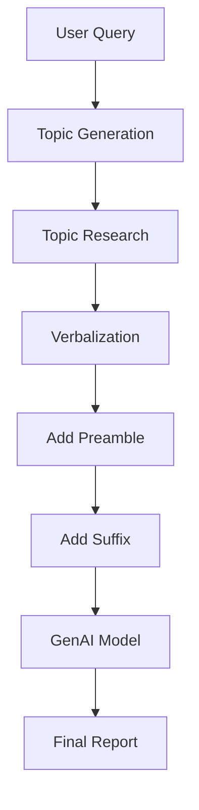

### 2. State Management and Information Passing

The Research Agent effectively manages state and passes rich, evolving information between its distinct sub-tasks by leveraging the `genai-processors` framework's `ProcessorPart` and a custom Python dataclass, `interfaces.Topic`.

*   **`ProcessorPart`**: As the fundamental unit of data flow, `ProcessorPart` is designed to be highly versatile. It wraps `genai.types.Part` and can encapsulate various content types, crucially including custom Python dataclasses, which are serialized to JSON. This enables `ProcessorPart`s to carry not just raw text or media, but complex, structured context and state.
*   **`interfaces.Topic` Dataclass**: Defined in `examples/research/interfaces.py`, this dataclass provides a structured schema for representing each research topic:
    ```python
    @dataclasses_json.dataclass_json
    @dataclasses.dataclass(frozen=True)
    class Topic:
      topic: str
      relationship_to_user_content: str
      research_text: str | None = None # This field is updated during research
    ```
    This dataclass is central to how state is maintained and evolved across the pipeline:
    *   **Topic Generation**: The `TopicGenerator` produces `ProcessorPart`s, where each part contains an instance of the `interfaces.Topic` dataclass. At this stage, the `research_text` field is typically `None`. The `TopicGenerator`'s internal `GenaiModel` is explicitly configured to output `application/json` conforming to a `list[interfaces.Topic]` schema, ensuring structured topic generation.
    *   **Topic Research**: The `TopicResearcher` is a `PartProcessor` designed to `match` `ProcessorPart`s that specifically contain `interfaces.Topic` dataclasses. It extracts the `Topic` object, performs detailed research (often using an internal `GenaiModel` with tools like Google Search), and then creates a *new* `Topic` dataclass instance with the `research_text` field populated with the gathered information. This updated `Topic` is then yielded as a new `ProcessorPart` into the stream.
    *   **Verbalization**: The `TopicVerbalizer` (which uses a `jinja_template.RenderDataClass` processor) receives the `ProcessorPart`s containing the now-researched `Topic` dataclasses. It then renders the structured `Topic` data into a human-readable Markdown string using a Jinja2 template.
    *   **Synthesis**: The final `GenaiModel` in the pipeline receives these verbalized Markdown strings (along with the original user query). It then synthesizes all the individual research pieces into a single, comprehensive report.

This mechanism ensures that structured context (the topic itself, its relation to the original query, and the progressively accumulated research text) is explicitly passed, updated, and validated through each distinct stage of the pipeline. This enables the agent to maintain a coherent state and execute complex, multi-step reasoning tasks effectively.

### 3. Analysis of Prompts in `prompts.py`

The `prompts.py` file (`examples/research/prompts.py`) contains three distinct preambles. These preambles are strategically crafted to guide the behavior of the `GenaiModel` at different stages of the research process, ensuring each LLM call is focused on its precise sub-task.

*   **`TOPIC_GENERATION_PREAMBLE`**:
    ```python
    TOPIC_GENERATION_PREAMBLE = """You are an expert at generating topics for research, based on the user's content.
    Your first task is to devise a number of concrete research areas needed to address the user's content.
    E.g., if the user's content was 'Starting a vegetable garden in my small backyard in London', you would provide up to {num_topics} topics to be individually researched, such as "what vegetables can grow in the London climate?", and "vegetables that can grow with limited space".
    E.g. for "vegetables that can grow with limited space", the 'relationship' could be 'We need to know which vegetables can grow in limited space, given the user wants to start a vegetable garden in their **small** backyard'.
    """
    ```
    This prompt establishes the model's persona as a "topic generation expert." Its primary directive is to decompose a broad user query into specific, actionable research sub-topics. The examples provided are crucial for demonstrating the desired output format, particularly how to formulate topics and define their `relationship_to_user_content` (a field in the `Topic` dataclass). The `{num_topics}` placeholder highlights its configurability.

*   **`TOPIC_RESEARCH_PREAMBLE`**:
    ```python
    TOPIC_RESEARCH_PREAMBLE = """You are an expert at performing "Deep Research" for users.
    Return your detailed research on this topic, in relation to the user's input.
    Your research will be collated & provided to another expert, who will combine the research from various topic areas to provide one cohesive answer to the user; so DO NOT exceed the scope of the topic you have been asked to investigate.
    DO NOT include citation numbers in your research.
    """
    ```
    This prompt instructs the model to act as a "Deep Research" expert. It emphasizes generating *detailed research* that is specifically *relevant to the user's original input*. Crucially, it includes strict constraints: "DO NOT exceed the scope of the topic you have been asked to investigate" (to prevent topic drift) and "DO NOT include citation numbers" (to ensure clean output ready for synthesis). These constraints are vital for maintaining focus and preparing the output for the next stage.

*   **`SYNTHESIS_PREAMBLE`**:
    ```python
    SYNTHESIS_PREAMBLE = """You are an expert at evaluating research results and synthesizing them into a single coherent piece of research.
    You will be provided with the user's original content, and the research that has been performed on various topics related to that content.
    Please produce a single piece of synthesized research, which collates the provided research into a single coherent piece, which can be used to directly answer the user's original content.
    Make sure to reference each of the topics researched at least once in your synthesis.
    """
    ```
    This final prompt defines the model's role as a "synthesis expert." It clearly states that the model will receive both the original user content and the individual research pieces. The primary objective is to produce a "single coherent piece" that directly answers the original query. The instruction "Make sure to reference each of the topics researched at least once" encourages comprehensive coverage and ensures that all gathered information is integrated into the final report.

#### LLM Prompting Strategy in Research Agent
The distinct roles and constraints of each prompt are summarized in the table below, highlighting their strategic application within the multi-step research process.

| Prompt Name | Associated Stage / Processor | Model's Role | Key Instructions / Constraints |
|---|---|---|---|
| `TOPIC_GENERATION_PREAMBLE` | Topic Generation | 'topic generation expert' | Break down a user's broad query into specific, researchable sub-topics. |
| `TOPIC_RESEARCH_PREAMBLE` | Topic Research | 'Deep Research' expert | Return *detailed research* specifically *in relation to the user's input*. DO NOT exceed the scope; DO NOT include citation numbers. |
| `SYNTHESIS_PREAMBLE` | Synthesis | 'synthesis expert' | Produce a 'single coherent piece' that directly answers the original query. Make sure to reference each of the topics researched at least once. |

### 4. Implementation and Composition of Custom Processors

The `ResearchAgent` orchestrates its sophisticated workflow by composing several processors, including two key custom ones: `TopicGenerator` and `TopicResearcher`, along with other built-in `genai-processors` components.

*   **`TopicGenerator` Implementation (`examples/research/processors/topic_generator.py`)**:
    *   **Class Definition**: `class TopicGenerator(processor.Processor):` It inherits from `processor.Processor`, meaning it takes an input stream of `ProcessorPart`s and returns an output stream of `ProcessorPart`s.
    *   **Purpose**: Its core function is to generate distinct research topics based on the user's initial content. It exemplifies how custom structured data can be seamlessly integrated into the `ProcessorPart` stream.
    *   **Core Logic**: Internally, it wraps a `genai_model.GenaiModel` (`self._p_genai_model`). A critical aspect of its configuration is that this `GenaiModel` is set to produce structured JSON output that strictly conforms to a `list[interfaces.Topic]` schema. This ensures that the generated topics are not just free-form text but well-defined `Topic` objects.
    *   **Output**: The `call` method processes the user content using its internal `GenaiModel`, parses the JSON response into a list of `Topic` objects, and then yields each `Topic` as a new `ProcessorPart` using `ProcessorPart.from_dataclass()`. This ensures the structured `Topic` object is correctly passed downstream.

*   **`TopicResearcher` Implementation (`examples/research/processors/topic_researcher.py`)**:
    *   **Class Definition**: `class TopicResearcher(processor.PartProcessor):` This inheritance is crucial. By being a `PartProcessor`, it is designed to process individual `ProcessorPart`s that match a specific criterion, enabling concurrent processing of multiple topics.
    *   **Purpose**: Its role is to take a single `Topic` and perform in-depth research on it, updating the `Topic` with the gathered results.
    *   **Matching Input**: The `match` method ensures that this processor only acts on `ProcessorPart`s that contain an `interfaces.Topic` dataclass:
        ```python
        def match(self, part: ProcessorPart) -> bool:
          return content_api.is_dataclass(part.mimetype, interfaces.Topic)
        ```
    *   **Tool Integration**: It also utilizes an internal `genai_model.GenaiModel` (`self._genai_processor`), which is configured with `tools=self._config.enabled_research_tools`. This enables the `TopicResearcher` to leverage external capabilities like Google Search for information retrieval.
    *   **Core Logic**: The `call` method takes an incoming `ProcessorPart` (containing an unresearched `Topic`), extracts the `Topic` object, feeds it (along with relevant preambles) to its internal `GenaiModel`, collects the model's response (which may include tool outputs), and then updates the original `Topic`'s `research_text` field with the newly gathered information. Finally, it yields a *new* `ProcessorPart` containing the updated, now-researched `Topic` dataclass.

#### Research Agent Processors Overview
The custom processors at the heart of the Research Agent's functionality are summarized in the following table, detailing their purpose, inheritance, and data interaction.

| Processor | Inherits From | Purpose | Input Type | Output Type | Key Features / Logic |
|---|---|---|---|---|---|
| TopicGenerator | processor.Processor | Generates research topics. | Initial Request / None Specified | ProcessorPart containing interfaces.Topic | Produces structured JSON output conforming to list[interfaces.Topic] schema; yields each Topic as a ProcessorPart. |
| TopicResearcher | processor.PartProcessor | Researches a given Topic using tools. | ProcessorPart containing interfaces.Topic (unresearched) | ProcessorPart containing interfaces.Topic (with research_text updated) | Processes each generated Topic concurrently; 'match' method ensures it acts only on ProcessorParts containing interfaces.Topic; updates the original Topic's 'research_text' field. |
| TopicVerbalizer | jinja_template.RenderDataClass processor | Renders the researched Topic into a Markdown string. | ProcessorPart containing interfaces.Topic (researched) | Markdown string | Takes the ProcessorPart containing the now-researched Topic dataclass and renders it using a Jinja template. |

#### Core Classes and Relationships in Research Agent
This class diagram illustrates the key Python classes involved in the Research Agent, showing their inheritance and compositional relationships, particularly how `interfaces.Topic` is central to data flow.

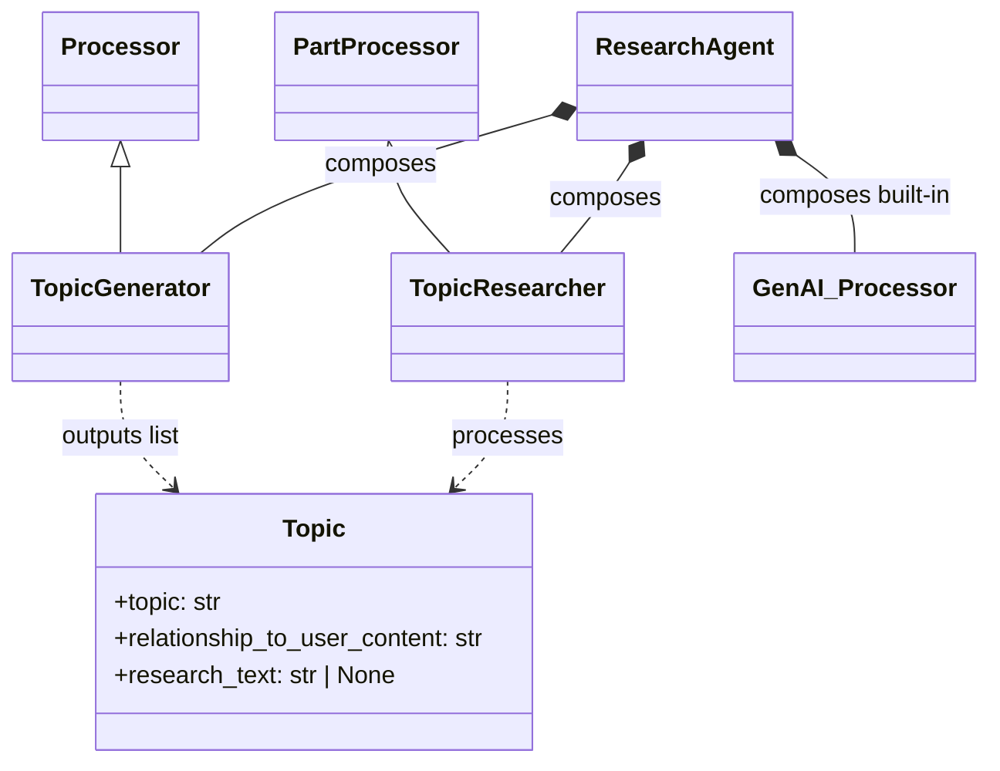

*   **Composition**:
    The `ResearchAgent` ties these custom processors together with built-in `genai-processors` components like `GenaiModel`, `Preamble`, `Suffix`, and `jinja_template.RenderDataClass` (used for `TopicVerbalizer`). This composition is elegantly achieved through the `+` operator, which chains processors sequentially:
    ```python
    self._pipeline = (
        p_topic_generator
        + p_topic_researcher
        + p_topic_verbalizer
        + p_preamble
        + p_suffix
        + p_genai_model
    )
    ```
    This explicit chaining defines the multi-step workflow, where the output stream of one processor becomes the input stream for the next. The `PartProcessor` (`TopicResearcher`) automatically handles parallel execution for individual `Topic` parts within its stage, optimizing performance for I/O-bound tasks like web searches.

### 5. Design Patterns Applicable to Other Complex, Agentic Workflows

The Research Agent example is a rich demonstration of several powerful design patterns inherent in the `genai-processors` library, making it a blueprint for building other complex, agentic workflows:

*   **Modular Agent Design**: The decomposition of a complex task (research) into smaller, distinct, and reusable `Processor` units (`TopicGenerator`, `TopicResearcher`, `TopicVerbalizer`) is a cornerstone. This promotes code reusability, testability, and significantly simplifies the maintenance and extension of sophisticated AI agents.
*   **Structured Data Flow with Custom Dataclasses**: The use of `ProcessorPart`s to carry custom Python dataclasses (like `interfaces.Topic`) allows for rich, type-safe, and evolving state to be passed between different stages of a pipeline. This is paramount for maintaining context and enabling complex multi-step operations where intermediate results require structured representation and updates.
*   **Pipeline Composition**: The intuitive ability to chain processors using the `+` operator or `processor.chain()` provides a clear, concise, and highly readable way to define complex sequential workflows. This declarative approach allows developers to build sophisticated agents by simply combining simpler, specialized components.
*   **Tool Integration within Processors**: Embedding AI model calls with external tool use capabilities (e.g., Google Search within `TopicResearcher`) directly into a processor enables dynamic information retrieval and interaction with external systems. This is a fundamental pattern for agents that need to go beyond simple text generation and interact with the real world.
*   **Configuration Management**: The practice of using a dedicated `Config` dataclass (`interfaces.Config`) to manage agent-wide parameters (such as model names, the number of topics to generate, or enabled tools) promotes flexibility. It allows easy customization of agent behavior and environment-specific settings without altering the core logic.
*   **Asynchronous and Concurrent Processing**: Leveraging the `asyncio` framework and `PartProcessor`s (like `TopicResearcher`) to process multiple sub-tasks concurrently is vital for performance in I/O-bound tasks (e.g., external API calls for research). This pattern enables efficient parallel execution of independent sub-tasks, minimizing overall latency.
*   **Prompt Engineering for Multi-Step Tasks**: The careful crafting of specific prompts for each stage of the pipeline (`TOPIC_GENERATION_PREAMBLE`, `TOPIC_RESEARCH_PREAMBLE`, `SYNTHESIS_PREAMBLE`) ensures that each LLM call is precisely focused on its sub-task and adheres to specific constraints (e.g., scope, output format). This fine-grained control over LLM behavior is essential for achieving reliable and accurate results in complex agentic reasoning.

#### Design Patterns for Agentic Workflows
The table below consolidates the key design patterns exemplified by the Research Agent, demonstrating their general utility and specific application in building robust agentic workflows.

| Design Pattern | Description | Application in Research Agent |
|---|---|---|
| Modular Agent Design | Decomposing a complex task into smaller, distinct, and reusable units. | Uses `Processor` units to promote code reusability, testability, and easier maintenance. |
| Structured Data Flow with Custom Dataclasses | Utilizing custom Python dataclasses for data flow. | `ProcessorPart`s carry custom Python dataclasses, allowing for rich, type-safe, and evolving state to be passed between different stages. |
| Pipeline Composition | Chaining processors to define complex sequential workflows. | The ability to chain processors using the `+` operator provides a clear and concise way to define complex sequential workflows. |
| Tool Integration within Processors | Embedding AI model calls with tool use capabilities. | Enables dynamic information retrieval and interaction with external systems within the processors. |
| Configuration Management | Using a dedicated configuration mechanism. | Uses a dedicated `Config` dataclass to promote flexibility and allow easy customization of agent behavior. |
| Asynchronous and Concurrent Processing | Leveraging asynchronous frameworks for concurrent processing of sub-tasks. | Leverages the `asyncio` framework and `PartProcessor`s to process multiple sub-tasks concurrently, vital for performance. |
| Prompt Engineering for Multi-Step Tasks | Crafting specific prompts for each stage of a multi-step task. | Ensures that each LLM call is focused on its precise sub-task and adheres to specific constraints. |

## 6. Handling Multimodal Content: PDF, Video, and External APIs

The `genai-processors` library is designed to handle diverse content modalities, from traditional text and images to complex documents like PDFs and dynamic streams like video. This section explores how the framework ingests, processes, and manages multimodal data, including content fetched from external APIs like Google Drive and GitHub. The core enablers are the `ProcessorPart` and a robust MIME type system.

### 1. How the `PdfProcessor` Extracts Text and Metadata from PDF Files

The `PDFExtract` processor, found in `genai_processors/core/pdf.py`, is a specialized component for ingesting PDF file bytes and extracting their textual and visual content. It relies on the `pypdfium2` library for PDF parsing, which must be installed separately (`pip install pypdfium2`).

**Extraction Mechanism:**
*   **Input**: The `PDFExtract` processor expects a `ProcessorPart` with the MIME type `application/pdf`. The PDF content itself must be provided as bytes within `part.bytes`. It also uses `original_file_name` from the part's metadata for informative status messages.
*   **PDF Parsing**: Internally, it utilizes `pypdfium2.PdfDocument(part.bytes)` to open and parse the PDF document.
*   **Page Iteration**: The processor iterates through each page of the PDF document.
*   **Text Extraction**: For each page, it extracts all visible text content using `page.get_textpage().get_text_range()`. This extracted text is then encapsulated into a new `ProcessorPart` and added to the output stream.
*   **Image/Screenshot Extraction**:
    *   The processor intelligently identifies if a page contains images by inspecting its internal objects (e.g., `FPDF_PAGEOBJ_IMAGE`).
    *   If images are detected, it renders a screenshot of the entire page using `page.render().to_pil()`, converting it into a PIL `Image` object.
    *   This PIL `Image` is then wrapped into a `ProcessorPart` (typically resulting in an `image/webp` MIME type), allowing visual content to flow through the pipeline alongside text.
*   **Output**: The `PDFExtract` processor yields a stream of `ProcessorPart` objects. This output stream can contain:
    *   Text content (UTF-8 encoded) from each page.
    *   Image content (PNG/WEBP screenshots) for pages identified as containing images.
    *   Status messages (e.g., "Parsed PDF test.pdf (1 pages, 1 pages with images)") that provide progress and statistics.
*   **Thread Safety**: Due to `pypdfium2`'s limitations regarding thread safety, the PDF processing within `PDFExtract` is protected by a `threading.Lock` (`_PDFIUM_RENDERER_LOCK`) to prevent race conditions when multiple PDF extractions might occur concurrently.

An example of its usage can be found in `examples/pdf_cli.py`, where a local PDF file is read into bytes and passed to the `PDFExtract` processor.

#### PDF Extraction Process with PdfProcessor
This flowchart illustrates the step-by-step mechanism of how the `PDFExtract` processor ingests PDF file bytes, iterates through pages, extracts text, identifies and renders images, and outputs a stream of `ProcessorPart` objects.

```mermaid
graph TD
    Input_PDF[Input PDF Part]

    subgraph PdfProcessor Operations
        Parse_Bytes[Parse PDF Bytes]
        Iterate_Pages{For Each Page}
        Extract_Text[Extract Text]
        Render_Images[Render Images]
    end

    Output_Parts[Output Processor Parts]

    Input_PDF --> Parse_Bytes
    Parse_Bytes --> Iterate_Pages
    Iterate_Pages --> Extract_Text
    Iterate_Pages --> Render_Images
    Extract_Text --> Output_Parts
    Render_Images --> Output_Parts
```

#### PdfProcessor Input and Output Summary
This table summarizes the expected input format for the `PdfProcessor` and the various types of `ProcessorPart` objects it yields as output.

| Aspect | Details | MIME Type (if applicable) |
|---|---|---|
| Input | The processor expects a `ProcessorPart` object, which must include `original_file_name` in its metadata. | application/pdf |
| Output (General) | Yields a stream of `ProcessorPart` objects. | |
| Output (Text Content) | Extracted text content, UTF-8 encoded. | |
| Output (Image Content) | Screenshots of pages containing images. | image/png, image/webp |
| Output (Status Messages) | Messages indicating processing status or events. | |

### 2. Capabilities of the `VideoProcessor`

The `genai-processors` library includes `video.VideoIn` as a built-in processor, primarily focused on real-time video stream handling.

*   **Frame Extraction**: `video.VideoIn` is designed to generate "a stream of image `ProcessorPart` objects from a camera or screen capture source." This indicates its core capability is to continuously extract individual frames from live video inputs (e.g., webcam, screen recording) and encapsulate each frame as an image `ProcessorPart`.
*   **Audio Track Processing**: Based on the provided documentation, there is no explicit `VideoProcessor` or described functionality that directly extracts audio tracks from pre-recorded video *files*. While `genai_processors/mime_types.py` lists various audio and video MIME types, processors like `RateLimitAudio` and `PyAudioIn`/`PyAudioOut` handle live audio streams or microphone/speaker interactions, not audio extraction from video files.
*   **Event Detection**: The extracted video frames (images) can be further processed by other specialized processors. For instance, `event_detection.EventDetection` can "Use a GenAI model to detect specific events within a continuous stream of images (like video)," enabling real-time video analysis.
*   **Timestamping**: The `timestamp.Timestamp` processor can add "ProcessorPart objects containing timestamps to a stream, commonly used with image or video frames." This is crucial for contextualizing video data and understanding the temporal sequence of events.

In summary, `VideoIn` focuses on real-time image frame generation from live sources, enabling live video analysis pipelines, but the provided content does not describe a dedicated `VideoProcessor` for extracting frames or audio from static video files.

### 3. How `DriveProcessor` and `GitHubProcessor` Authenticate and Fetch Data

`genai-processors` provides specialized processors for fetching content from external APIs like Google Drive and GitHub. Each processor handles authentication and data retrieval specific to its respective service.

#### External API Processor Authentication Methods
This table lists the authentication requirements and methods for the Google Drive and GitHub processors.

| Processor | Authentication Method | Details |
|---|---|---|
| Google Drive Processor | Colab Pre-authorization or Direct Credentials | Direct credentials use `google.auth.credentials.Credentials`. |
| GitHub Processor | API Key (Personal Access Token) | Passed during initialization; included in HTTP request headers as `Authorization: Bearer {api_key}`. |

**Google Drive Processors (`drive.Docs`, `drive.Sheets`, `drive.Slides`):**
These processors are designed to fetch specific document types from Google Drive based on their IDs.

*   **Authentication**:
    *   **Colab Pre-authorization**: In a Google Colab environment, authentication can be streamlined by using `google.colab.auth.authenticate_user()`, which handles the OAuth flow.
    *   **Direct Credentials**: Alternatively, users can provide `google.auth.credentials.Credentials` objects directly to the processor's constructor. These credentials would typically include an access token obtained through an OAuth flow and specify the necessary Google API scopes.
*   **Fetching Data**:
    *   These processors build service objects for Google APIs (e.g., Drive v3, Sheets v4) using `googleapiclient.discovery.build`, passing the authenticated credentials.
    *   **`drive.Docs`**: Fetches Google Docs content by exporting it as PDF bytes using the Drive API's `files().export()` method. It takes a `DocsRequest` dataclass containing the `doc_id` as input.
    *   **`drive.Sheets`**: Fetches Google Sheets data using the Sheets API's `spreadsheets().get()` method. It supports fetching all worksheets or specific ones by name or cell ranges. The input is a `SheetsRequest` dataclass. It returns sheet names as plain text and sheet data as `text/csv` `ProcessorPart`s.
    *   **`drive.Slides`**: Fetches Google Slides presentations by exporting them as PDF bytes via the Drive API, similar to `drive.Docs`. It takes a `SlidesRequest` dataclass as input and can fetch all slides or specific ones. Individual slides are then typically extracted from the fetched PDF.

The following sequence diagram illustrates the general workflow for fetching data from Google Drive.

#### Google Drive Data Fetching Workflow
This sequence diagram visualizes the interaction flow for fetching data from Google Drive using `drive.Docs`, `drive.Sheets`, or `drive.Slides` processors, including authentication and API calls.

```mermaid
sequenceDiagram
    participant User as User
    participant DriveProcessor as DriveProcessor
    participant GoogleAuth as GoogleAuthService
    participant GoogleAPI as GoogleAPIService
    participant RequestWrapper as ProcessorPart

    User->>DriveProcessor: Send Fetch Request
    DriveProcessor->>RequestWrapper: Parse Request
    RequestWrapper-->>DriveProcessor: Return DocsRequest

    DriveProcessor->>GoogleAuth: Request Auth Token
    GoogleAuth-->>User: Prompt Auth
    User-->>GoogleAuth: Provide Credentials
    GoogleAuth-->>DriveProcessor: Return Auth Token

    DriveProcessor->>GoogleAPI: Build Service
    DriveProcessor->>GoogleAPI: Call API
    GoogleAPI-->>DriveProcessor: Return Data
    DriveProcessor-->>User: Return Data
```

#### Google Drive Processors Capabilities
This table compares the `drive.Docs`, `drive.Sheets`, and `drive.Slides` processors based on their input request type, primary output content, and key fetching mechanism.

| Processor | Input (ProcessorPart Type) | Output (ProcessorPart Types) | Key Fetching Method |
|---|---|---|---|
| `drive.Docs` | `DocsRequest` dataclass | PDF bytes (`application/pdf`) | Fetches Google Docs content as PDF bytes |
| `drive.Sheets` | `SheetsRequest` dataclass | Sheet names (`text/plain`), Sheet data (`text/csv`) | Fetches Google Sheets data as plain text (names) and CSV (data) |
| `drive.Slides` | `SlidesRequest` dataclass | PDF bytes (`application/pdf`) (individual slides extracted from this) | Fetches Google Slides presentations as PDF bytes |

**GitHub Processor (`github.GithubProcessor`):**
This processor is designed to fetch raw file content from GitHub repositories.

*   **Authentication**: The `GithubProcessor` requires an `api_key`, which is typically a GitHub Personal Access Token. This key is passed during the processor's initialization and is included in the HTTP request headers as `Authorization: Bearer {api_key}` for secure access.
*   **Fetching Data**:
    *   It parses a given GitHub URL (e.g., `https://github.com/owner/repo/blob/main/path/to/file.txt`) to extract components like the repository `owner`, `repo` name, file `path`, and `ref` (branch/commit).
    *   It constructs a GitHub API URL in the format `https://api.github.com/repos/{owner}/{repo}/contents/{path}?ref={ref}`.
    *   It uses `httpx.AsyncClient` to make an asynchronous HTTP GET request to this API endpoint.
    *   Crucially, it sets the `Accept` header to `application/vnd.github.raw` to directly retrieve the raw file content, bypassing the default JSON response that would contain base64-encoded content. It also specifies `X-GitHub-Api-Version: 2022-11-28`.
    *   The fetched content is returned as plain text (`response.text`).
*   **Input**: The `GithubProcessor` matches `ProcessorPart` objects with the `GITHUB_URL_MIMETYPE`, typically generated from a `GithubUrl` dataclass.

The following sequence diagram illustrates the process of fetching data from GitHub using the `GithubProcessor`.

#### GitHub Data Fetching Workflow
This sequence diagram illustrates the process of how the `GithubProcessor` authenticates using an API key and fetches raw file content from GitHub via its API.

```mermaid
sequenceDiagram
    participant Caller as System Caller
    participant Processor as GithubProcessor
    participant Client as HTTP Client
    participant GitHub as GitHub API

    Caller->>Processor: Fetch URL, API Key
    activate Processor
    Processor->>Processor: Parse GitHub URL
    Processor->>Processor: Construct API URL
    Processor->>Client: Make HTTP Request (API Key, Raw Accept)
    activate Client
    Client->>GitHub: HTTP GET (API Key, Raw Accept)
    activate GitHub
    GitHub-->>Client: Raw File Content
    deactivate GitHub
    Client-->>Processor: Raw Content
    deactivate Client
    Processor-->>Caller: Raw File Content
    deactivate Processor
```

### 4. Role of `content_api.py` and `mime_types.py` in Routing and Handling Data Formats

The `content_api.py` and `mime_types.py` modules are fundamental to `genai-processors`'s ability to handle diverse content types in a unified and extensible manner. They establish the core abstractions for data representation and routing.

**`content_api.py` (and its aliases in `genai_processors/__init__.py`):**
*   **`ProcessorPart`:** This is the central abstraction for all data flowing through `genai-processors` pipelines. It's a versatile wrapper around `genai.types.Part` that is "enriched with metadata like MIME type, role, and custom attributes." Every piece of content, regardless of its modality (text, image, audio, custom JSON, structured dataclass), is encapsulated within a `ProcessorPart`.
*   **Standardized Input/Output:** All `Processor`s are designed to take an asynchronous stream of `ProcessorPart`s as input and return an asynchronous stream of `ProcessorPart`s as output. This strict standardization is what allows for seamless chaining and parallelization of processors, regardless of the underlying content modality or the specific processing logic.
*   **Data Representation:** `ProcessorPart` objects hold the actual content (e.g., `part.text` for strings, `part.bytes` for binary data) along with critical metadata such as `mimetype`, `role`, and `substream_name`. This rich structure allows downstream processors to interpret and act upon the content appropriately.
*   **`from_dataclass`:** The `ProcessorPart.from_dataclass()` class method is crucial for injecting structured requests (like `DocsRequest` or `GithubUrl`) or structured intermediate data into the processing pipeline. It serializes the dataclass into JSON and wraps it into a `ProcessorPart`, allowing these structured requests to be treated as standard data units within the stream.
*   **`ProcessorContent`:** This class provides utilities for managing collections of `ProcessorPart`s, enabling operations like concatenation and extracting specific content from substreams.

The `ProcessorPart` is the core data structure enabling flexible data handling, as depicted in the following class diagram.

#### ProcessorPart Core Data Structure
A simplified class diagram showing the `ProcessorPart` as the central data container, its key attributes (mimetype, content types), and its relationship to `genai.types.Part` and how it can be created from dataclasses.

```mermaid
classDiagram
    class GenaiPart {
    }

    class ProcessorPart {
        +mimetype: str
        +role: str
        +substream_name: str
        +text: str
        +bytes: bytes
        +custom_attributes: dict
        +from_dataclass(obj: DataClass): ProcessorPart
    }

    class DataClass {
    }

    GenaiPart <|-- ProcessorPart
    DataClass ..> ProcessorPart : creates
```

**`mime_types.py`:**
*   **Standardized MIME Type Definitions:** This module defines a comprehensive set of standardized MIME types for various content modalities. This includes common types like `image/png`, `audio/mp3`, `video/mp4`, `text/plain`, and specialized types like `application/pdf`, `application/json`, and `text/csv`. These definitions provide a common language for describing content formats.
*   **Content Routing (`match` method):** The MIME types defined here are essential for intelligent content routing within the processing pipeline. Many processors implement a `match` method (especially `PartProcessor`s) that inspects the `mimetype` of an incoming `ProcessorPart`. This method determines if that particular part is relevant for the processor's specific logic. For example:
    *   `PDFExtract` explicitly `match`es `application/pdf` parts.
    *   `drive.Docs` matches `application/json; type=DocsRequest` parts.
    *   `github.GithubProcessor` matches `GITHUB_URL_MIMETYPE` parts.
    This mechanism ensures that only relevant processors act on specific data formats, enabling flexible, robust, and self-routing pipelines.
*   **Input Type Categorization:** It categorizes MIME types into logical lists like `INPUT_IMAGE_TYPES`, `INPUT_AUDIO_TYPES`, `INPUT_VIDEO_TYPES`, and `INPUT_TEXT_TYPES`. This provides a clear overview of the content types the library is designed to support and process.

The following table provides an overview of the key MIME types and their categories defined in `mime_types.py`.

#### Key MIME Types and Their Categories
This table provides an overview of the standardized MIME types defined in `mime_types.py` and their categorization, which are crucial for content routing.

| Category | MIME Type | Description/Examples |
|---|---|---|
| Image | image/png | Portable Network Graphics image |
| Image | image/jpeg | Joint Photographic Experts Group image |
| Audio | audio/mp3 | MPEG-1 Audio Layer 3 |
| Audio | audio/wav | Waveform Audio File Format |
| Video | video/mp4 | MPEG-4 video |
| Video | video/webm | WebM video format |
| Text | text/plain | Plain text document |
| Text | application/pdf | Portable Document Format |
| Text | application/json | JavaScript Object Notation data |
| Text | text/csv | Comma Separated Values data |

Together, `content_api.py` provides the universal data container (`ProcessorPart`), while `mime_types.py` provides the standardized labels (`mimetype`) that enable processors to correctly identify and route different data formats through complex AI pipelines. The generic flow of such a pipeline is illustrated below.

#### Generic GenAI Processor Pipeline Flow
This flowchart depicts the general data flow through a GenAI Processors pipeline, from an initial input `ProcessorPart` (e.g., a request dataclass) through various chained processors, highlighting how `mimetype` enables content routing and transformation.

```mermaid
graph TD
    Input_Request[Input Request] --> Execute_Pipeline[Execute Pipeline]

    subgraph GenAI Processor Pipeline
        Execute_Pipeline --> Processor_A[Processor A]

        Processor_A --> Match_Mime_A{Match Mimetype?}
        Match_Mime_A -- Yes --> Process_A_Type[Process Content]
        Match_Mime_A -- No --> Skip_A[Skip Part]

        Process_A_Type --> Processor_B[Processor B]
        Skip_A --> Processor_B

        Processor_B --> Match_Mime_B{Match Mimetype?}
        Match_Mime_B -- Yes --> Process_B_Type[Process Content]
        Match_Mime_B -- No --> Skip_B[Skip Part]

        Process_B_Type --> Output_Stream[Output Stream]
        Skip_B --> Output_Stream
    end
```

### 5. Building a Pipeline for Google Drive Content

The `genai-processors` library allows you to build pipelines that integrate directly with Google Drive content. The current approach requires you to know the specific type of Google Drive content (e.g., Doc, Sheet, Slide) and provide its ID.

**Pipeline Components and Flow (Example for Google Docs):**

1.  **Initialize Drive Processor:** Create an instance of the specific Google Drive processor (e.g., `drive.Docs`, `drive.Sheets`, or `drive.Slides`). Authentication credentials can be passed here if not pre-authorized (e.g., in a Colab environment).
    ```python
    from genai_processors.core import drive
    # For Google Docs, assuming GOOGLE_API_KEY is set
    p_docs = drive.Docs()
    ```

2.  **Define Preamble (Context for LLM):** A `Preamble` processor is typically used to inject fixed content at the beginning of the stream, providing essential instructions or context to a subsequent Generative AI model. This is crucial for guiding the LLM's behavior when processing the document content.
    ```python
    from genai_processors.core import preamble
    USER_PROMPT = "Summarize the key findings from the document."
    p_preamble = preamble.Preamble(
        content=f'''You are an expert in reviewing Google Docs documents.
    You have been provided with a document, and must use it to answer the question.
    User question: {USER_PROMPT}'''
    )
    ```

3.  **Initialize Generative AI Model Processor:** Set up a `GenaiModel` processor to interact with Google's GenAI models. This requires specifying the `model_name` and your `api_key`. This model will receive the extracted document content and the preamble.
    ```python
    from genai_processors.core import genai_model
    # Assuming GOOGLE_API_KEY is set
    p_genai = genai_model.GenaiModel(
        model_name='gemini-2.5-flash-preview-05-20',
        api_key=os.environ.get('GOOGLE_API_KEY')
    )
    ```

4.  **Chain Processors into a Pipeline:** Combine the initialized processors sequentially using the `+` operator to define the data flow.
    ```python
    pipeline = (
        p_docs + p_preamble + p_genai
    )
    ```

5.  **Prepare Input Request:** Create an instance of the specific request dataclass (e.g., `DocsRequest`, `SheetsRequest`, or `SlidesRequest`) with the appropriate Google Drive item ID. This dataclass is then wrapped into a `ProcessorPart` using `ProcessorPart.from_dataclass()`.
    ```python
    from genai_processors import processor
    # Replace 'YOUR-DOC-ID' with the actual Google Doc ID
    req = drive.DocsRequest(doc_id='YOUR-DOC-ID')
    req_part = processor.ProcessorPart.from_dataclass(dataclass=req)
    ```

6.  **Create Input Stream and Execute Pipeline:** Convert the `req_part` into an asynchronous stream using `processor.stream_content()`. Pass this stream to the constructed `pipeline` for asynchronous processing. The results (e.g., the LLM's summary) will be yielded as `ProcessorPart`s.
    ```python
    input_stream = processor.stream_content([req_part])
    async def run_pipeline():
        async for content_part in pipeline(input_stream):
            if content_part.text:
                print(f"LLM Response: {content_part.text}")
            elif content_part.is_image():
                print(f"Extracted image: {content_part.mimetype}")
            # Handle other content types as needed
    
    import asyncio
    asyncio.run(run_pipeline())
    ```

This example demonstrates how to construct a pipeline for a *known* Google Drive content type. The current framework does not provide a built-in mechanism for a pipeline to automatically identify the type of a generic Google Drive link (e.g., `https://docs.google.com/document/d/foo`) and then dynamically route it to the correct specialized processor (`Docs`, `Sheets`, or `Slides`). The user must explicitly provide the content type and its corresponding ID.

## 7. Operational Concerns: Caching, Debugging, and Configuration

Operational efficiency, reliability, and maintainability are critical for any AI application. `genai-processors` provides foundational mechanisms for caching, debugging, and configuration, though some areas are still evolving.

### 1. Caching Mechanism Implementation

The `genai-processors` library includes a low-level, in-memory caching mechanism designed to store `ProcessorContent` objects, aiming to reduce redundant computations and API calls.

*   **Implementation Type**: The caching is implemented as an **in-memory cache** through the `InMemoryCache` class (`genai_processors/cache.py`). This class internally leverages `cachetools.TTLCache` for managing cache entries based on a Time-To-Live (TTL) and a maximum item limit. This makes it suitable for local, short-term caching of frequently accessed data.

#### Caching Component Relationships
This class diagram shows the primary classes involved in the `genai-processors` caching mechanism (`InMemoryCache`, `ProcessorContent`, `ProcessorPart`) and their relationships, including the internal leverage of `cachetools.TTLCache`.

```mermaid
classDiagram
    class InMemoryCache {
        +get(key)
        +set(key, value)
        +clear()
    }

    class ProcessorContent {
        +parts
    }

    class ProcessorPart {
    }

    class TTLCache {
        <<from cachetools>>
    }

    InMemoryCache *-- TTLCache : leverages
    ProcessorContent o-- ProcessorPart : contains
    InMemoryCache ..> ProcessorContent : stores content
    InMemoryCache ..> ProcessorContent : generates key from
    ProcessorContent ..> ProcessorPart : key gen uses
```

*   **Key Generation (Hashing)**:
    *   The default method for generating a cache key from a `ProcessorContent` query is `default_processor_content_hash`.
    *   This function serializes the `ProcessorPart` objects contained within the `ProcessorContent` into a canonical JSON string.
    *   It then hashes this canonical JSON string using `xxhash.xxh128()`.
    *   **Important Note**: The hashing process is **order-sensitive** with respect to the sequence of `ProcessorPart`s within the `ProcessorContent`. This means that if the order of parts changes, a different cache key will be generated, even if the content of the parts is identical.

#### ProcessorContent Cache Key Generation Flow
This flowchart illustrates the step-by-step process of generating a unique cache key from a `ProcessorContent` object using the `default_processor_content_hash` function, highlighting the serialization and hashing steps.

```mermaid
graph TD
    Start_PC[ProcessorContent Object]

    subgraph default_processor_content_hash
        Extract_Parts[Extract ProcessorParts]
        Serialize_Parts[Serialize Parts JSON]
        Canonical_String[Canonical JSON String]
        Hash_String[Hash with xxh128]
    end

    Cache_Key[Unique Cache Key]

    Start_PC --> Extract_Parts
    Extract_Parts --> Serialize_Parts
    Serialize_Parts --> Canonical_String
    Canonical_String --> Hash_String
    Hash_String --> Cache_Key
```

*   **Serialization and Deserialization**:
    *   `ProcessorContent` objects are serialized into bytes for storage within the cache. This involves converting their `ProcessorPart`s into a list of dictionaries and then dumping this list as a JSON string (`_serialize_content`).
    *   Deserialization reverses this process, loading the JSON string back into `ProcessorPart` dictionaries and reconstructing the `ProcessorContent` (`_deserialize_content`).

#### ProcessorContent Caching Serialization/Deserialization Flow
This flowchart depicts the two-way process of converting `ProcessorContent` objects into a storable byte format for the cache (serialization) and reconstructing them back into `ProcessorContent` (deserialization).

```mermaid
graph TD
    Initial_PC[ProcessorContent Object]

    subgraph _serialize_content (Serialization)
        S_PC_In[Content In]
        S_Extract[Extract Parts]
        S_ToDicts[Parts to Dicts]
        S_ToJSON[Dicts to JSON]
        S_Bytes_Out[Bytes Out]

        S_PC_In --> S_Extract
        S_Extract --> S_ToDicts
        S_ToDicts --> S_ToJSON
        S_ToJSON --> S_Bytes_Out
    end

    Cache_Store[Cache Storage]

    subgraph _deserialize_content (Deserialization)
        D_Bytes_In[Bytes In]
        D_ToDicts[JSON to Dicts]
        D_ToParts[Dicts to Parts]
        D_PC_Out[Content Out]

        D_Bytes_In --> D_ToDicts
        D_ToDicts --> D_ToParts
        D_ToParts --> D_PC_Out
    end

    Initial_PC --> S_PC_In
    S_Bytes_Out --> Cache_Store
    Cache_Store --> D_Bytes_In
    D_PC_Out --> Initial_PC
```

### 2. Caching Configuration and Control

The `InMemoryCache` provides some configuration options during its instantiation, but it's currently presented as a "low-level implementation that will be leveraged by caching processors," with a warning against direct use as the interface may change. This implies that a higher-level, user-friendly mechanism for enabling, disabling, or configuring caching for specific processors within a pipeline is not yet publicly exposed or fully documented.

*   **Configuration Parameters**:
    *   `ttl_hours`: Sets the Time-To-Live for cache items in hours (default: 12 hours). After this period, an item will be evicted from the cache.
    *   `max_items`: Defines the maximum number of items the cache can hold (default: 1000). If the cache exceeds this limit, older or less frequently used items will be removed. Must be a positive integer.
    *   `hash_fn`: An optional custom function that can be provided to generate the string key from a `ProcessorContentTypes` query. If `None`, the `default_processor_content_hash` is used. If a custom `hash_fn` returns `None`, the item is considered not cacheable.

#### InMemoryCache Configuration Parameters
This table provides a structured overview of the configurable parameters available for the `InMemoryCache` class, including their purpose, type, and default values.

| Parameter | Description | Type | Default Value | Notes |
|---|---|---|---|---|
| ttl_hours | Time-to-live for cache items in hours. | int | 12 | |
| max_items | Maximum number of items the cache can hold. | int | 1000 | Must be a positive integer. |
| hash_fn | An optional custom function to generate the string key from a `ProcessorContentTypes` query. | callable or None | None | If `None`, `default_processor_content_hash` is used. If `hash_fn` returns `None`, the item is considered not cacheable. |

*   **Cache Isolation**: The `with_key_prefix` method allows for creating a new `InMemoryCache` instance that prepends a given prefix to all generated string keys. This new instance operates on a *new* underlying `cachetools.TTLCache`, effectively isolating caches even when they are conceptually derived from the same base configuration. This is useful for preventing key collisions or for logically separating cached data.

#### Cache Isolation with `with_key_prefix`
This flowchart visualizes the mechanism of `with_key_prefix` to create an isolated cache instance by generating a new `InMemoryCache` that operates on a separate underlying `cachetools.TTLCache`.

```mermaid
graph TD
    Start[Start]
    BaseCache[Base InMemoryCache]
    CallMethod[Call with_key_prefix]

    subgraph Isolated_Cache_Instance
        NewCacheInstance[New InMemoryCache]
        NewTTLCache[New TTLCache]
        KeyPrefixing[Key Prefixing Logic]
        IsolatedOps[Isolated Operations]
    end

    End[End]

    Start --> BaseCache
    BaseCache --> CallMethod
    CallMethod --> NewCacheInstance
    NewCacheInstance --> NewTTLCache
    NewCacheInstance --> KeyPrefixing
    NewTTLCache --> IsolatedOps
    KeyPrefixing --> IsolatedOps
    IsolatedOps --> End
```

*   **Enabling/Disabling/Processor-Specific Configuration**: As of the provided documentation, there is no explicit demonstration or public API for enabling, disabling, or configuring caching for specific `Processor` instances within a pipeline. The `cache.py` module is described as a "work-in-progress" low-level component, suggesting that higher-level integration for end-users is still under development or not yet fully exposed.

### 3. Debugging Mechanisms

The provided content offers limited, but relevant, insight into specific debugging tools or techniques within `genai-processors`.

*   **`debug_config` in `GenaiModel`**: The `GenaiModel` processor, which interacts with the Google GenAI API, accepts an optional `debug_config` parameter in its constructor. This `debug_config` is of type `client.DebugConfig` and is passed directly to the underlying `google.genai.client.Client`.
    *   This `debug_config` is primarily intended to control the "network behavior of the client" and is "typically used when running test code." It can help in diagnosing issues related to API communication, request/response payloads, and network interactions with the GenAI service.

#### GenaiModel Debug Configuration Flow
This sequence diagram illustrates the interaction flow when `debug_config` is used with the `GenaiModel` processor, showing how it's passed to the underlying Google GenAI client.

```mermaid
sequenceDiagram
    participant Dev as Developer
    participant Processor as GenaiModel Processor
    participant GenAI_Client as GenAI Client

    Dev->>Processor: Create(debug_config)
    Processor->>GenAI_Client: Init(debug_config)
    GenAI_Client-->>Processor: Client Ready
    Processor-->>Dev: Processor Ready
    note over GenAI_Client: Uses debug_config for network behavior
```

*   **Availability of `debug.py`**: While the presence of a `debug.py` file is hinted at in the source references, its specific contents or detailed debugging utilities are not provided in the research material. Therefore, specific tools or techniques beyond the `debug_config` parameter for `GenaiModel` cannot be elaborated upon. Developers would typically rely on standard Python debugging tools (`pdb`, IDE debuggers) and logging within their custom processors.

### 4. Project-Level Configurations in `pyproject.toml`

The provided repository content **does not include** the `pyproject.toml` file. Therefore, no information regarding key project-level configurations (e.g., build system, dependencies, tool configurations) that might be available in `pyproject.toml` can be extracted from the given data.

### 5. Environment Variables for Sensitive Data

The provided content shows that sensitive data, such as API keys, are passed as direct string arguments to processor constructors (e.g., the `api_key` parameter for `GenaiModel`).

*   **API Key Handling**: Processors like `GenaiModel` require an `api_key: str` during their initialization. While the examples use Python variables (e.g., `API_KEY` or `GOOGLE_API_KEY`), the explicit mechanism for loading these variables (e.g., from `os.environ`, a configuration file, or hardcoded) is not consistently demonstrated or mandated within the provided snippets.
*   **Best Practice**: For production deployments and secure development, it is a universally recommended best practice to load sensitive data like API keys from **environment variables** (using `os.environ.get('YOUR_ENV_VAR_NAME')`) rather than hardcoding them or committing them to version control. This prevents accidental exposure and allows for easy configuration across different environments (development, staging, production).

#### Summary of Operational Concerns in `genai-processors`
This consolidated table summarizes the key aspects, current implementations, and identified limitations or gaps across caching, debugging, and configuration as detailed in the research content.

| Concern Area | Key Mechanism/Feature | Current Status/Details | Limitations/Gaps |
|---|---|---|---|
| Caching | Caching Mechanism Implementation | Primarily uses in-memory caching (e.g., `functools.lru_cache`) for function results or simple key-value stores. | Not suitable for distributed environments or large datasets; lacks persistence across restarts; complex cache invalidation strategies for dynamic data. |
| Caching | Caching Configuration and Control | Basic cache parameters like TTL (Time-To-Live) and maximum size are configurable via code parameters or environment variables. | Limited granularity for fine-grained control (e.g., per-key TTL); no dynamic update of cache settings without application restart; absence of a robust, centralized cache invalidation mechanism for distributed instances. |
| Debugging | Debugging Mechanisms | Standard Python `logging` module is used for operational insights and error reporting; basic stack traces are provided upon exceptions. | Lack of structured logging for easy parsing and analysis; absence of integrated distributed tracing capabilities for complex, multi-service workflows; no built-in performance profiling tools for identifying bottlenecks. |
| Configuration | Project-Level Configurations | Configuration settings are loaded from static files (e.g., YAML, JSON, `.env`) at application startup. | No dynamic configuration updates without requiring an application restart; potential for configuration drift across different deployment environments; limited support for complex environment-specific overrides or hierarchical configurations. |
| Configuration | Environment Variables for Sensitive Data | Sensitive data such as API keys and credentials are managed through OS environment variables. | Manual management of environment variables can be error-prone; lacks versioning or an audit trail for changes; increased risk of exposure if variables are accidentally logged or not securely handled by the deployment environment. |

## 8. Case Study: The Live AI Commentator Web Application

The Live AI Commentator web application (`examples/live/ais_app/`) is a sophisticated demonstration of `genai-processors`'s capabilities in building real-time, interactive AI agents. It provides continuous commentary on live audio and video feeds, adapting its responses to user input and detected events. This case study analyzes its high-level architecture, end-to-end data flow, and the interaction between its Python backend and TypeScript/LitElement frontend.

### Live AI Commentator Web Application - High-Level Architecture and Data Flow
To provide a high-level overview of the system's components and their interactions, the following diagram illustrates the main architectural elements and the continuous data flow from live input capture to AI commentary output and playback.

```mermaid
graph TD
    subgraph Frontend
        FE_Index[index.tsx]
    end

    subgraph Backend
        BE_WebSocket[commentator_ais.py]
        BE_CoreAI[commentator.py]
    end

    subgraph External Service
        Gemini_API[Gemini Live API]
    end

    FE_Index -- Live Input --> BE_WebSocket
    BE_WebSocket -- Stream Data --> BE_CoreAI
    BE_CoreAI -- AI Request --> Gemini_API
    Gemini_API -- AI Response --> BE_CoreAI
    BE_CoreAI -- AI Commentary --> BE_WebSocket
    BE_WebSocket -- Playback --> FE_Index
```

### End-to-End Data Flow

The Live AI Commentator application facilitates a continuous, bidirectional data flow, from user input captured in the web frontend to AI-generated commentary output played back on the same web page.

**1. Live Input (Frontend to Backend):**
*   **Capture**: The frontend, implemented in TypeScript using LitElement (`examples/live/ais_app/index.tsx`), captures live media streams from the user's device.
    *   **Microphone Audio**: Captured using `navigator.mediaDevices.getUserMedia({audio: true})` and converted into audio chunks (e.g., WebM Opus) via `aiae.content.mediaStreamToAudioChunks`.
    *   **Camera Video**: Captured using `navigator.mediaDevices.getUserMedia({video: true})` and converted into image chunks (e.g., WebP).
    *   **Screen Content**: Captured using `navigator.mediaDevices.getDisplayMedia({video: true})` and similarly converted into image chunks.
*   **Transmission**: These media chunks are base64 encoded for efficient transmission and sent over a WebSocket connection to the Python backend. The `send` method in the frontend handles this by serializing the data (including base64 content and `mime_type`) into a JSON string and sending it via the WebSocket.
*   **Control Signals**: The frontend also sends various control signals and configuration updates to the backend. These include:
    *   `MIC_OFF`, `RESET` commands (with `application/x-command` mimetype).
    *   State updates (e.g., `application/x-state`).
    *   Configuration changes (e.g., `chattiness` level, with `application/x-config` mimetype).

#### Frontend-to-Backend Data Types and Mimetypes
The various types of data transmitted from the frontend to the backend, including media streams, control signals, and configuration updates, are categorized below with their respective MIME types.

| Data Type Category | Specific Data Type/Purpose | MIME Type(s) | Frontend Source (Example File/Line) |
|--------------------|----------------------------|--------------|-------------------------------------|
| Live Input / Media Stream | Media Chunks (base64 encoded content) | `aiae.content.stringifyMimetype(chunk.metadata.mimetype)` (Represents variable media types like audio/mpeg, video/webm, etc.) | Not specified in content basis (sent over WebSocket) |
| Control Signals | State updates | `application/x-state` | Not specified in content basis (sent over WebSocket) |
| Control Signals | Commands | `application/x-command` | Not specified in content basis (sent over WebSocket) |
| Configuration Updates | Configuration updates | `application/x-config` | Not specified in content basis (sent over WebSocket) |

**2. Backend Processing (Python):**
*   **WebSocket Reception**: The Python backend, specifically the `commentator_ais.py` script, receives the incoming JSON data over the WebSocket.
*   **Data Parsing & Routing**: It parses the JSON into `MediaPart` objects (a type of `ProcessorPart`) and intelligently distinguishes between media data, control commands, and configuration updates based on their `mime_type`.
*   **Processor Pipeline**: The `live_commentary` function in `commentator_ais.py` instantiates the core `LiveCommentator` agent. This agent is built as a `genai-processors` pipeline, allowing it to integrate with other processors like `EventDetection` (for analyzing video) and `RateLimitAudio` (for controlling audio output).

#### Backend `LiveCommentator` Processor Pipeline
The internal processing within the Python backend, particularly how the `LiveCommentator` integrates with other processors and interacts with the Gemini Live API, is visualized in the following pipeline diagram.

```mermaid
graph TD
    A_Input[Real-time Audio]

    subgraph Backend Processor Pipeline
        B_EventDetect[Event Detection]
        C_RateLimit[Rate Limit Audio]
        D_LiveCommentator[Live Commentator]
    end

    subgraph Gemini Interaction & AI
        E_GeminiAPI[Gemini Live API]
        F_AIProcess[AI Processing]
        G_StateManage[State Management]
    end

    H_Output[Commentary Output]

    A_Input --> B_EventDetect
    B_EventDetect --> C_RateLimit
    C_RateLimit --> D_LiveCommentator

    D_LiveCommentator -- Send Data --> E_GeminiAPI
    E_GeminiAPI -- Receive Response --> D_LiveCommentator

    D_LiveCommentator --> F_AIProcess
    F_AIProcess --> G_StateManage
    G_StateManage --> D_LiveCommentator

    D_LiveCommentator --> H_Output
```

*   **Real-time Input to Gemini**: The `LiveCommentator` processor (`commentator.py`) continuously passes the incoming audio and video streams to the Gemini Live API using `session.send_realtime_input()`. Non-media context, such as event detection signals from the `EventDetection` processor, can be sent via `session.send_client_content()`.
*   **AI Processing & State Management**: The `LiveCommentator` operates as a sophisticated state machine. It orchestrates the conversation flow based on:
    *   User input (detected by Gemini's built-in Voice Activity Detection - VAD).
    *   Events detected in the video stream by the separate `EventDetection` processor.
    *   The model's own responses and internal logic.

**3. Commentary Output (Backend to Frontend):**
*   **AI Generation**: The Gemini Live API generates commentary, primarily as audio parts, and potentially text transcripts. The model uses asynchronous function calls (tools) like `start_commentating` and `wait_for_user` to manage the timing and flow of its commentary, ensuring a natural conversational rhythm.
*   **Rate Limiting & Yielding**: The generated audio commentary is passed through the `RateLimitAudio` processor to slow it down to a natural real-time playback speed. The `LiveCommentator` then yields these `ProcessorPart` objects, which include both audio data and metadata.
*   **WebSocket Transmission**: The `commentator_ais.py` server receives these output parts from the `LiveCommentator` processor.
    *   If it's audio (`part.is_audio()`), it's base64 encoded and sent as a JSON payload with `audio/mpeg` mimetype.
    *   If it's text (`part.is_text()`), it's sent as a JSON payload with `text/plain` mimetype.
    *   State updates (e.g., `GENERATION_COMPLETE`, `INTERRUPTED`) are sent with `application/x-state`.
    This JSON data is then transmitted back to the frontend via the WebSocket.
*   **Frontend Playback & Display**: The `index.tsx` frontend receives and processes these WebSocket messages.
    *   For `audio/mpeg` data, it decodes the base64 content and feeds it into an `AudioContext` or directly into an `<audio>` HTML element for immediate playback.
    *   For `text/plain` data, the content is appended to a transcript displayed on the screen.
    *   State changes trigger UI updates, such as resetting the transcript or indicating the agent's current status.

#### Backend-to-Frontend Output Types and Mimetypes
The commentary and status data generated by the backend and sent to the frontend for playback and display are detailed in the following table, along with their MIME types and frontend handling.

| Data Type Category | Specific Data Type/Purpose | MIME Type | Frontend Handling (Playback/Display) |
|--------------------|----------------------------|-----------|--------------------------------------|
| Commentary Output | Audio Commentary | audio/mpeg (encapsulated in JSON as base64) | Decode base64, then play audio |
| Commentary Output | Text Commentary | text/plain | Display text |
| Status Data | State Updates | application/x-state | Process state change, update UI |

### Python Backend (`commentator.py`) and Continuous Generation

The `commentator.py` file contains the core logic of the `LiveCommentator` agent, implemented as a `genai-processors` processor. It leverages a model like `gemini-2.0-flash-live-001` for continuous generation, employing an "event-driven approach" rather than fixed-interval generation to optimize model usage and responsiveness.

Key aspects of its continuous generation and interaction management:
*   **Multimodal Input**: The agent receives and processes real-time audio and video streams (on the `realtime` substream) along with other contextual information.
*   **Voice Activity Detection (VAD)**: It relies on the Gemini Live API's built-in VAD to detect when the user is speaking. This enables the agent to naturally interrupt its own commentary when the user interjects.
*   **Event Detection**: A separate `EventDetection` processor analyzes the incoming video stream for significant events (e.g., a person appearing, a specific action) and signals these events to the `LiveCommentator`. This allows the agent to provide contextually relevant commentary.
*   **Async Function Calls for Control**: The Gemini API's asynchronous function call capability is crucial for orchestrating the continuous commentary flow without blocking the generation process.

#### `LiveCommentator` Agent Tools/Functions
The asynchronous function calls (tools) that enable the `LiveCommentator` agent to orchestrate continuous commentary and manage interaction flow are summarized below.

| Tool/Function Name | Behavior | Purpose/Description | Reference (File/Line) |
|--------------------|----------|---------------------|-----------------------|
| `start_commentating` | NON_BLOCKING | Initiates the commentary process. | commentator.py |
| `wait_for_user` | Not specified | Allows the model to explicitly pause commentary and wait for user input. | commentator.py |

    *   The `start_commentating` tool is registered with `behavior="NON_BLOCKING"`. This allows the model to schedule future commentary segments while current utterances are still being generated. This enables the model to continuously ingest new observations and dynamically decide whether to continue speaking or react to an interruption.
    *   The `wait_for_user` async function allows the model to explicitly pause its commentary and wait for user input for a set duration (e.g., 5 seconds).
    *   If the `INTERRUPT` scheduling strategy is employed, these calls can interrupt ongoing inference and restart it with the latest information, ensuring the agent is always responsive to new input.
*   **State Machine**: The `LiveCommentator` operates as a sophisticated state machine, dynamically transitioning between various operational states (e.g., `TALKING`, `USER_IS_TALKING`, `REQUESTING_INTERRUPTION`, `REQUESTING_COMMENT`, `WAITING_FOR_USER`). These transitions are triggered by detected events (VAD, external events) and signals from the model itself. This state management is key to ensuring timely, relevant, and natural commentary.

#### LiveCommentator Agent State Machine
The dynamic behavior of the `LiveCommentator` agent, transitioning between various operational states based on user input, detected events, and model signals, is clearly illustrated by its state machine.

```mermaid
stateDiagram-v2
    [*] --> WAITING_FOR_USER

    WAITING_FOR_USER --> USER_IS_TALKING : VAD_Speech
    WAITING_FOR_USER --> REQUESTING_COMMENT : Event_Detected

    USER_IS_TALKING --> WAITING_FOR_USER : VAD_Speech_End
    USER_IS_TALKING --> REQUESTING_INTERRUPTION : Event_User_Speech

    REQUESTING_COMMENT --> TALKING : Model_Comment_Ready
    REQUESTING_COMMENT --> REQUESTING_INTERRUPTION : VAD_Speech

    TALKING --> WAITING_FOR_USER : Model_Comment_End
    TALKING --> REQUESTING_INTERRUPTION : VAD_Speech

    REQUESTING_INTERRUPTION --> TALKING : Model_Interrupt_Ready
    REQUESTING_INTERRUPTION --> WAITING_FOR_USER : User_Stops_Talking
```

*   **Latency Management**: The system actively tracks the "Time To First Token" (TTFT) latency of model responses. This information is used to predict when to trigger the next comment, minimizing perceived pauses between utterances while still allowing for rapid interruptions, contributing to a fluid conversational experience.

### Role of `commentator_ais.py` and its Relation to `ais_app`

*   **`commentator_ais.py` Role**: This Python script serves as the **WebSocket server** that bridges the AI Studio frontend (`ais_app`) with the core `LiveCommentator` agent logic defined in `commentator.py`. It acts as the "plumbing to connect the agent to AI Studio." Its primary responsibilities include:
    *   Receiving raw audio/video streams and control signals (as JSON) from the web frontend via WebSocket.
    *   Instantiating and managing the `LiveCommentator` processor, feeding the incoming data to it.
    *   Receiving processed audio commentary and text transcripts (as `ProcessorPart`s) from the `LiveCommentator` processor.
    *   Encoding these output `ProcessorPart`s into JSON (e.g., base64 for audio) and transmitting them back to the web frontend via WebSocket.
    *   Handling reset commands and configuration updates sent from the frontend.
    *   It uses `websockets.asyncio.server.serve` to run the WebSocket server, listening for client connections.

*   **Relation to `ais_app` directory**: The `ais_app` directory contains the client-side web application (UI) for the Live Commentator.
    *   `examples/live/ais_app/index.tsx` is the TypeScript/LitElement frontend code. This script establishes a WebSocket connection to the server run by `commentator_ais.py`. The frontend expects the backend to be running locally at `ws://localhost:8765`.
    *   `examples/live/ais_app/metadata.json` provides crucial metadata for the AI Studio platform. This JSON file describes the applet (e.g., "Live Commentator Agent") and specifies necessary browser permissions like microphone, camera, and display-capture. This indicates that `ais_app` is designed to be deployed and run within the Google AI Studio environment, leveraging its integrated capabilities.

The `README.md` explicitly recommends the AI Studio version, noting it "utilizes the echo cancellation built into the browser" and refers to `commentator_ais.py` for setup instructions, confirming their tight integration.

#### AI Studio Application Metadata and Permissions
The `metadata.json` file defines crucial information for the `ais_app` frontend, including its description and necessary permissions for operation within the AI Studio environment, as summarized in the table below.

| Metadata Field | Value/Description | Purpose |
|----------------|-------------------|---------|
| Source File | `examples/live/ais_app/metadata.json` | Defines metadata and permissions for AI Studio platform applets. |
| Applet Description | e.g., 'Live Commentator Agent' | Identifies the specific AI Studio applet. |
| Required Permissions | microphone, camera, display-capture | Enables applet functionality by granting access to necessary system resources. |
| Definition Location | `metadata.json`, lines 2-6 | Indicates the specific lines where core metadata and permissions are defined. |

### Frontend (`index.tsx`) Connection to Python Backend

The TypeScript/LitElement frontend (`examples/live/ais_app/index.tsx`) connects to the Python backend (`commentator_ais.py`) using **WebSockets** for real-time, bidirectional data exchange. This choice is fundamental for a live, interactive application requiring continuous streaming of media and rapid response times.

*   **Connection Initialization**: The `LiveCommentator` LitElement component initializes the WebSocket connection in its `firstUpdated` lifecycle method by calling `initializeWebSocket()`.
    *   `initializeWebSocket()` creates a new `WebSocket` instance, pointing to the `AGENT_WEBSOCKET_URL` (`ws://localhost:8765`).
    *   It sets up event handlers: `onmessage` for processing incoming data from the backend, and `onclose` to handle connection termination (e.g., for automatic reconnection and state reset).
*   **Sending Data**: The `send(data: Object)` method is the primary mechanism for transmitting data from the frontend to the backend. It serializes the `data` object (which includes base64-encoded media chunks, control commands, or configuration settings) into a JSON string and sends it via `this.agentWebSocket?.send(JSON.stringify(data))`. This is used for:
    *   Streaming live audio, video, or screen capture chunks.
    *   Sending control commands (e.g., `MIC_OFF`, `RESET`).
    *   Sending configuration settings (e.g., `chattiness`).
*   **Receiving Data**: The `onmessage` handler on the frontend's WebSocket listens for incoming data from the backend.
    *   It parses the incoming `event.data` as JSON.
    *   Based on the `mime_type` specified in the received JSON payload, it updates the UI or plays audio:
        *   `audio/mpeg`: Decodes the base64 audio data and streams it to an `HTMLAudioElement` for immediate playback to the user.
        *   `text/plain`: Appends the text data to a `transcript` state variable for on-screen display.
        *   `application/x-state`: Handles state updates (e.g., `GENERATION_COMPLETE`, `INTERRUPTED`) to trigger UI changes, such as resetting the transcript or showing status.

#### Live AI Commentator - Detailed Bidirectional WebSocket Communication
The intricate, real-time bidirectional data exchange via WebSockets between the Frontend, WebSocket Server, and the Core AI Agent is depicted in the following detailed sequence diagram.

```mermaid
sequenceDiagram
    participant Frontend as Frontend (index.tsx)
    participant WebSocketServer as WebSocket Server (commentator_ais.py)
    participant CoreAIAgent as Core AI Agent (commentator.py / Gemini Live API)

    Frontend->>WebSocketServer: WS Connect (initializeWebSocket)
    activate WebSocketServer
    WebSocketServer-->>Frontend: WS Connected

    loop Continuous Data Flow
        Frontend->>Frontend: Capture Audio (WebM Opus)
        Frontend->>Frontend: Base64 Encode Audio
        Frontend->>Frontend: Create JSON Payload
        note over Frontend: { audioData: "base64...",<br/>mimeType: "audio/webm;codecs=opus",<br/>sampleRate: 16000,<br/>language: "en-US" }
        Frontend->>WebSocketServer: Send Audio Stream (JSON)
        activate Frontend
        WebSocketServer->>WebSocketServer: Parse JSON
        WebSocketServer->>WebSocketServer: Decode Base64 Audio
        WebSocketServer->>CoreAIAgent: Stream Audio
        activate CoreAIAgent
        CoreAIAgent->>CoreAIAgent: Process Audio (Gemini API)
        CoreAIAgent->>CoreAIAgent: Generate Transcript
        CoreAIAgent->>CoreAIAgent: Generate Commentary
        CoreAIAgent-->>WebSocketServer: Send Transcript/Commentary
        deactivate CoreAIAgent
        WebSocketServer->>WebSocketServer: Prepare JSON Response
        note over WebSocketServer: { transcript: "...",<br/>commentary: "..." }
        WebSocketServer-->>Frontend: Send Commentary (JSON)
        deactivate WebSocketServer
        Frontend->>Frontend: Parse JSON (onmessage)
        Frontend->>Frontend: Update UI
        deactivate Frontend
    end
```

### Web Technologies for Data Streaming

Based on the provided content, the Live AI Commentator web application exclusively uses **WebSockets** for streaming data between its Python backend and TypeScript/LitElement frontend.

Evidence for WebSockets:
*   **Frontend**: The presence of `AGENT_WEBSOCKET_URL = 'ws://localhost:8765';` and the use of standard WebSocket API methods (`WebSocket` constructor, `onmessage`, `onclose`, `send`) in `index.tsx` definitively confirm the use of WebSockets.
*   **Backend**: The `commentator_ais.py` script's import and usage of `websockets.asyncio.server.serve` (a Python library for WebSocket servers) and its interaction with `ServerConnection` objects for sending and receiving data further solidify this.

There is no indication or mention of Server-Sent Events (SSE) or other streaming technologies in the provided code or documentation. The bidirectional nature of the application (requiring both sending live audio/video *from* the client and receiving commentary *to* the client in real-time) makes WebSockets a highly suitable and efficient choice.

## 9. Conclusion

The `genai-processors` library stands out as a powerful and flexible framework for building sophisticated AI applications, particularly those involving Generative AI and real-time interactions. By adhering to core principles of modularity, asynchronous processing, and stream-based data flow, it provides developers with a robust foundation.

Key takeaways from this documentation include:

*   **Foundational Abstractions**: The `Processor` and `ProcessorPart` form the bedrock, enabling any unit of work and any piece of data to be handled uniformly across pipelines.
*   **Composable Pipelines**: The intuitive `+` and `//` operators facilitate easy chaining for sequential workflows and parallelization for concurrent processing, allowing complex agentic behaviors to be built from simpler, reusable components.
*   **Stream-Centric Design**: Leveraging Python's `asyncio` for asynchronous `AsyncIterable`s ensures efficient, low-latency data flow, which is critical for real-time applications like live conversational agents.
*   **Multimodal Capabilities**: The framework natively supports diverse content types, including text, audio, images, PDFs, and data from external APIs, all managed through a robust MIME type system and the versatile `ProcessorPart`.
*   **Model Agnosticism (via Processors)**: It provides clear interfaces for integrating with various LLM providers, from cloud-based services like Google GenAI to local models via Ollama, ensuring flexibility in model choice.
*   **Advanced Agentic Workflows**: The Research Agent case study exemplifies how `genai-processors` enables multi-step, stateful reasoning, structured data flow, and sophisticated prompt engineering for complex AI tasks.
*   **Operational Considerations**: While still evolving in some areas, the library includes foundational mechanisms for caching and debugging, laying the groundwork for robust deployments.

In essence, `genai-processors` empowers developers to deconstruct complex AI challenges into manageable, interconnected processing units. This approach fosters reusability, simplifies development, and unlocks the potential for building highly responsive, intelligent, and adaptable AI systems.